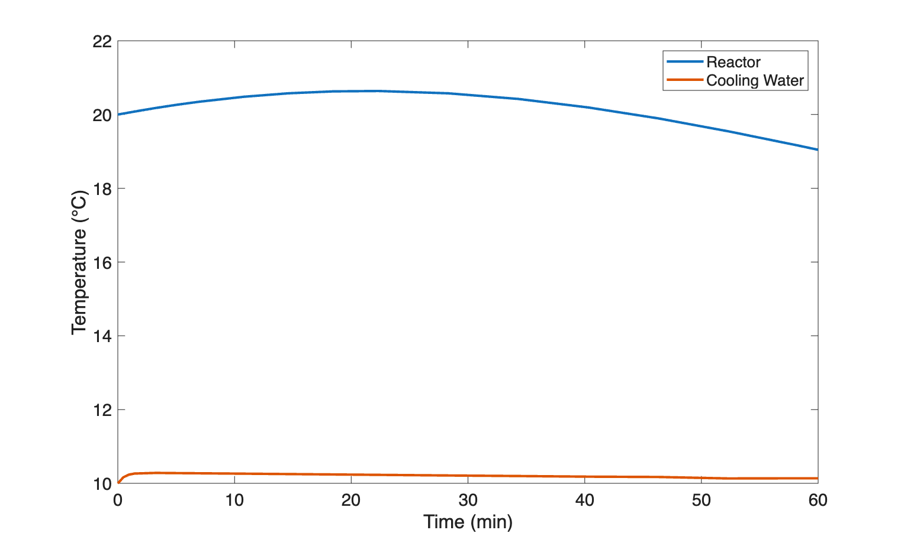
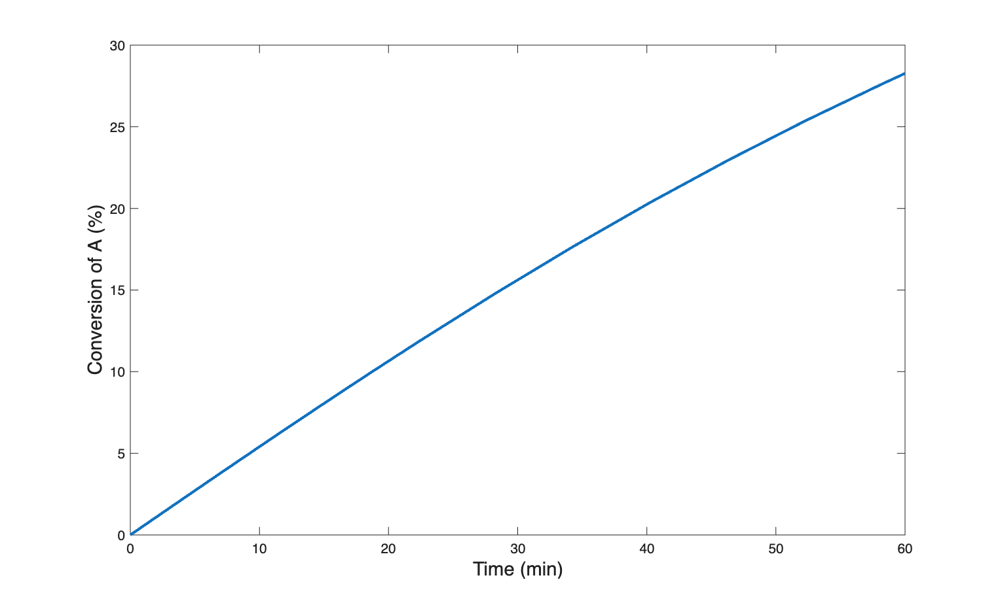

```{=latex}
\vspace{-1.5cm}
```

Before summarizing the assignment, the file, `activity_18.m`, was created for performing the calculations. Within it a function of the same name was declared. Each of the blocks of code listed below are added to this file to complete the function for performing the calculations.

```matlab
function activity_18()
% Calculations for the Class 18 Learning Activity from REB, The Course
```

# Assignment Summary

[Reaction]{.underline}

$$
A \rightarrow Z \tag{1}
$$

[Rate Expression]{.underline}

$$
r_1 = k_1 C_A \tag{2}
$$

[Reactor]{.underline}: Non-adiabatic, liquid-phase BSTR

&nbsp;

[Given Constants]{.underline}: $\Delta H_1$ = –16.6 kcal mol^–1^, $C_{A,0}$ = 2 M, $T_0$ = 20 °C, $k_{0,1}$ = 2.5 x 10^8^ L mol^–1^ min^–1^, $E_1$ = 14.3 kcal mol^–1^, $V$ = 0.4 L, $V_{ex}$ = 0.1 L, $A$ = 32.5 cm^2^, $U$ = 0.2 cal min^–1^ cm^–2^ K^–1^, $T_{ex,0}$ = $T_{ex,in}$ = 10 °C, $\rho_{ex}$ = 1 g cm^–3^, $\tilde{C}_{p,ex}$ = 1 cal g^–1^ K^–1^, $\dot{m}_{ex,0}$ = 217 g min^–1^, $\dot{m}_{ex} \big|_{t_f}$ = 212 g min^–1^, $t_f$ = 60 min, $\rho$ = 879 g L^–1^, and $\tilde{C}_p$ = 0.42 cal g^–1^ K^–1^.

```matlab
    %global constants available to all functions
    %given
    dH1 = -16600; %cal /mol
    CA_0 = 2; %mol /L
    T0 = 20 + 273.15; %K
    k01 = 2.5E8; %L /mol /min
    E1 = 14300; %cal /mol
    V = 0.4; %L
    V_ex = 100; %cm^3
    A_ex = 32.5; %cm^2
    U_ex = 0.2; %cal /min /cm^2 /K
    Tex0 = 10 + 273.15 #K
    Tex_in = 10 + 273.15; %K
    rho_ex = 1; %g /cm^3
    Cp_ex = 1; %cal /g /°C
    mDot0 = 217; %g /min
    d_mDot = 212; %g /min
    tf = 60; %min
    Cp = 0.42; %cal /g /°C
    rho = 879; %g /L
    %known
    R = 1.987; %cal / mol / K
    %calculated
    nA0 = CA_0*V;
```

[Given Equation]{.underline}

$$
\dot{m}_{ex} = \frac{212}{60} t + 217 \tag{3}
$$

```matlab
    % given equation
    mDot = @(t) d_mDot/tf * t + mDot0;
```

[Task]{.underline}: Parametric analysis

* [Parameter]{.underline}: $t$
* [Quantities of Interest]{.underline}: $\underline{f}_A$, $\underline{T}$, and $\underline{T}_{ex}$ *vs.* $\underline{t}$ as graphs.

&nbsp;

[Other Deliverable]{.underline}: Assessment of reactor isothermality.

# Preliminary Analysis

The initial coolant flow rate was likely chosen so to match the initial heat release, and thereby keep the reacting fluid temperature constant. As the reaction progresses, the rate will decrease due to decreasing reactant temperature (assuming constant reaction temperature), and consequently the heat release will decrease. If heat removal continued at the original rate, the temperature would drop. By decreassing the coolant flow rate over time, the rate of heat removal will be decreased. The key question is whether the linear decrease in coolant flow will result in a heat removal rate that matches the heat generation rate over time.

# BSTR Model Function

[BSTR Design Equations]{.underline}

$$
\frac{dn_A}{dt} = -r_1 V \tag{4}
$$

$$
\frac{dn_Z}{dt} = r_1 V \tag{5}
$$

$$
\frac{dT}{dt} = \frac{\dot{Q} - r_1V \Delta H_1}{\rho V \tilde{C}_p} \tag{6}
$$

$$
\frac{dT_{ex}}{dt} = \frac{-\dot{Q} - \dot{m}_{ex} \tilde{C}_{p,ex}\left(T_{ex} - T_{ex,in}\right)}{\rho_{ex} V_{ex} \tilde{C}_{p,ex}} \tag{7}
$$

[BSTR Model Variables]{.underline}: $\underline{t}$, $\underline{n}_A$, $\underline{n}_Z$, $\underline{nT}$, and $\underline{T}_{ex}$.

[Additional Computable Unknowns]{.underline}: $r_1$, $k_1$, $C_A$, $\dot{Q}$, and $\dot{m}_{ex}$

$$
k_1 = k_{0,1} \exp{ \left( \frac{-E_1}{RT}\right)} \tag{8}
$$

$$
C_A = \frac{n_A}{V} \tag{9}
$$

$$
\dot{Q} = U_{ex} A_{ex} \left(T_{ex} - T\right) \tag{10}
$$



[IVODE Solver Requirements]{.underline}

1. Initial values

$$
t_{iv} = 0 \tag{11}
$$

$$
n_{A,iv} = n_{A,0} = C_{A,0}V \tag{12}
$$

$$
n_{Z,iv} = 0 \tag{13}
$$

$$
T_{iv} = T_0 \tag{14}
$$

$$
T_{ex,iv} = T_{ex,0} \tag{15}
$$

2. Stopping criterion

$$
t = t_f \tag{16}
$$

3. Derivatives function (see below)

```matlab
    %BSTR reactor function
    function [t, nA, nZ, T, Tex] = bstr_model_variables()
        %set the initial values
        ind_0 = 0;
        dep_0 = [nA0, 0, T0, Tex0];

        %set the stopping criterion
        stopVar = 0;
        stopVal = tf;

        %solve the design equations
        odes_are_stiff=true;
        [t, dep, success, message] = solve_ivodes(ind_0, dep_0, stopVar...
            , stopVal, @bstr_derivatives, odes_are_stiff);
        
        %check for solver issues
        if ~success
            disp('')
            disp(["BSTR model issue: ", message])
            disp('Press any key to continue or CTRL-C to exit')
            pause
        end
        
        % return the bstr model variables
        nA = dep(:,1);
        nZ = dep(:,2);
        T = dep(:,3);
        Tex = dep(:,4);
    end
```

# BSTR Derivatives Function

1. receives the BSTR model variables ($t$, $n_A$, $n_Z$, $T$, and $T_{ex}$) at the start of an integration step
2. calculates additional unknowns using equations (2), (3), (8), (9), and (10)
3. evaluates and returns design equation design equation derivatives using equations (4) through (7)

```matlab
    % BSTR derivatives function
    function ddt = bstr_derivatives(t, dep)
        %extract the dependent variables
        nA = dep(1);
        T = dep(3);
        Tex = dep(4);

        %calculate the additional unknowns
        k1 = k01 * exp(-E1/(R*T));
        CA = nA / V;
        r1 = k1 * CA;
        Q = U_ex * A_ex * (Tex - T);

        %evaluate the derivatives
        dnA_dt = -r1 * V;
        dnZ_dt = r1 * V;
        dT_dt = (Q - r1*V*dH1) / (rho*V*Cp);
        dTex_dt = (-Q - mDot(t)*Cp_ex*(Tex - Tex_in)) / (rho_ex*V_ex*Cp_ex);

        %return the derivatives as a column vector
        ddt = [dnA_dt; dnZ_dt; dT_dt; dTex_dt];
    end
```

# Items of Interest Function

1. Call the BSTR model function to get $\underline{t}$, $\underline{n}_A$, $\underline{n}_Z$, $\underline{nT}$, and $\underline{T}_{ex}$.
2. Calculate the conversion and the maximum and minimum reaction fluid temperatures (to check isothermality)

$$
\underline{f}_A = \frac{n_{A,0} - \underline{n}_A}{n_{A,0}} \tag{17}
$$

$$
T_{max} = \max{\left(\underline{T}\right)} \tag{18}
$$

$$
T_{min} = \min{\left(\underline{T}\right)} \tag{19}
$$

3. Generate the requested graphs.

```matlab
    % items of interest function
    function items_of_interest()
        %solve the BSTR design equations
        [t, nA, ~, T, Tex] = bstr_model_variables();

        %tabulate, show, and save results
        item = ["Conversion"; "Maximum T"];
        value = [100*(nA0 - nA(end))/nA0; max(T) - 273.15];
        units = ["%"; "°C"];
        resultsTable = table(item, value, units);
        disp('')
        disp(resultsTable)
        disp('')
        writetable(resultsTable, 'results.csv');

        figure
        plot(t, T-273.15, t, Tex-273.15, 'LineWidth', 2)
        xlabel('Time (min)', 'FontSize', 14)
        ylabel('Temperature (°C)','FontSize', 14)
        legend({"Reactor","Cooling Water"})
        set(gca, 'FontSize', 14)
        saveas(gcf,'T_profiles.png')

        figure
        plot(t, 100*(nA0-nA)/nA0, 'LineWidth', 2)
        xlabel('Time (min)','FontSize', 14)
        ylabel('Conversion of A (%)','FontSize', 14)
        saveas(gcf,'fA_profile.png')
    end

    % perform the calculations
    items_of_interest();
end
```

# Results

The calculations were performed by calling the function, `activity_18`.

```matlab
>> activity_18
        item        value     units
    ____________    ______    _____

    "Conversion"    28.267    "%"  
    "Maximum T"     20.638    "°C" 
    "Minimum T"     19.044    "°C" 
```

The temperature profiles are shown in @fig-temp_profiles and the conversion profile is shown in @fig-conv_profile.

{#fig-temp_profiles width="70%"}

{#fig-conv_profile width="70%"}

# Discussion

By linearly decreasing the coolant flow rate as described above, the heat release and heat removal rates were nearly equal. The maximum and minimum temperatures were within 1 °C of the initial temperature.

# Summary

The reactor is effectively isothermal with a temperature variation of less than 1 °C. The temperature and conversion profiles are shown in @fig-temp_profiles and @fig-conv_profile.
