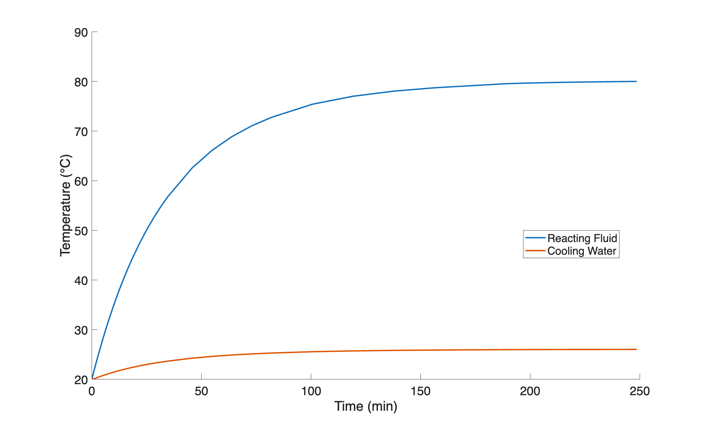
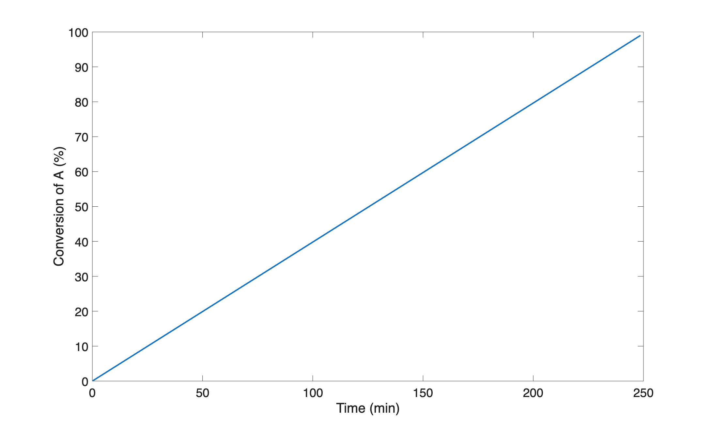

::: {.content-hidden unless-format="pdf"}

```{=latex}
\vspace{-1.5cm}
```

Before summarizing the assignment, the file, `act_19.m`, was created for performing the calculations. Within it a function of the same name was declared. Each of the blocks of code listed below are added to this file to complete the function for performing the calculations.

```matlab
function act_19()
% Calculations for the Class 19 Learning Activity from REB, The Course
```

:::

::: {.content-hidden unless-format="html"}

:::{.callout-tip collapse="true"}
## Click Here to See What an Expert Might be Thinking at this Point

I'll start by reading through the assignment narrative and creating a concise assignment summary. (basis or not) I'll use common variables symbols to represent the given quantities, making sure that the symbol I use is consistent with the quantity's units. (nomenclature, e. g. I'll use underlined variable symbols to represent arrays containing more than one value of the variable. I'll use a subscripted "0" to denote initial values and a subscripted "f" to denote final values.) 

(given equations or implicit values such as mole fractions that aren't given and equal zero)

(identification of task type, items of interest needed to make assessment or recommendation)

:::

:::

::: {.content-hidden unless-format="pdf"}

# Assignment Summary

:::

::: {.content-hidden unless-format="html"} 

<center>**Assignment Summary**</center>

:::

[Reaction]{.underline}

$$
A + B \rightarrow 2 Z \tag{1}
$$

[Rate Expression]{.underline}

$$
r_1 = k_1 C_A C_B \tag{2}
$$

[Reactor]{.underline}: Non-adiabatic, liquid-phase SBSTR

[Given Constants]{.underline}: $\Delta H_1$ = –184 kJ mol–1, $k_{0,1}$ = 4.866 x 10^11^ m^3^ mol^–1^ min^–1^, $E_1$ = 74.1 kJ mol^–1^, $V_0$ = 4.0 L, $C_{A,0}$ = 10 mol L^–1^, $T_0$ = 20°C, $T_{ex,in}$ = 20 °C, $V_{ex}$ = 500 cm^3^, $A$ = 550 cm^2^, $U$ = 8480 J m^–2^ min^–1^ K^–1^, $\dot{V}_{ex,in}$ = 1.0 L min^–1^, $T_{ex,0}$ = 20 °C, $\tilde{C}_p$ = $\tilde{C}_{p,ex}$ = 1 cal g^–1^ K^–1^, $\rho$ = $rho_{ex}$ = 1 g cm^–3^, $C_{B,in}$ 10 M, $T_{in}$ = 20 °C, and $T_{max}$ = 80 °C.

::: {.content-hidden unless-format="pdf"}

The given and known constants and the basis are converted to consistent units and the given equations are converted to anonymous functions and all are addded to `act_19`. 

```matlab
    % global constants available to all functions
    % given
    dH_1 = -184000.0; % J/mol
    k0_1 = 4.866E14; % L/mol/min
    E_1 = 74100.0; % J/mol
    P = 1.0; % atm
    V0 = 4.0; % L
    CA0 = 10.0; % mol /L
    T0 = 20 + 273.15; % K
    Tex0 = 20 + 273.15; % K
    Vex = 500.0/1.0E3; % L
    Aex = 550.0/1.0E4; % m^2
    U = 8480.0; % J/m^2/min/K
    Vdot_ex = 1.0; % L/min
    Tex0 = 20 + 273.15; % K
    Cp = 4.184; % J/g/K
    rho = 1.0E3; % g /L
    CBin = 10.0; % mol/L
    Tex_in = 20 + 273.15; % K
    Tin = 20 + 273.15; % K
    Tmax = 80.0 + 273.15; % K
    % known
    R = 8.3136; % J/mol/K
    Rpv = 8.206E-2; % L-atm/mol/K
    % calculated
    nA0 = CA0*V0;
    nAf = 0.01*nA0;
```

:::

[Task]{.underline}: Analysis

* [Item of Interest]{.underline}: $\dot{V}_{in,max}$ : $\underline{T} \le T_{max}$ 

::: {.content-hidden unless-format="pdf"}

# Preliminary Analysis

The concentration of A will decrease continually due to consumption by reaction. Taken alone, this would cause the rate to decrease. The temperature is expected to increase initially under the assumption that the heat released by the reaction is greater than the heat removed by the cooling water. Initially the increase in temperature is expected to predominate over the decrease in reactant concentration causing the reaction rate to rise.

While the reaction rate is rising, the rate of heat release will be increasing. The rate of heat removal by the cooling water will also increase, but by less than the heat generation. As time progresses, the effect of decreasing concentration will become prodominant. That will reduce the rate of reaction and by extension, the rate of heat release. The temperature is expected to pass through a maximum and then decrease.

The optimum feed rate will keep the heat release low enough to allow the cooling water to remove sufficient heat that the maximum temperature reaches 80 °C.

:::

::: {.content-hidden unless-format="html"}

<center>**Preliminary Analysis**</center>

:::

(qualitative analysis)

::: {.content-hidden unless-format="html"}

:::{.callout-tip collapse="true"}
## Click Here to See What an Expert Might be Thinking at this Point

I'm going to need to solve the SBSTR Design equations to complete this assignment, so I'll start by defining a SBSTR model function. To do that I'll need to 

* generate and simplify the design equations, 
* identify the SBSTR model variables I'll get by solving them, 
* identify any additional computable unknowns they contain and write the equations for calculating them,
* identify any non-computable unknows that will need to be passed to the BSTR model function as arguments, and
* determine the type of equation solver that I'll need and what input it will require.

Mole balances are always needed, and I prefer to write a mole balance for every reagent in the system other than solvent. (discuss simplification)

(reacting fluid energy balance)

(momentum balance)

(exchange fluid energy balance)

(differential ideal gas law - explain why needed)

:::

:::

::: {.content-hidden unless-format="pdf"}

# SBSTR Model Function

:::

::: {.content-hidden unless-format="html"}

<center>**SBSTR Model Function**</center>

:::

[SBSTR Design Equations]{.underline}

$$
\frac{dn_A}{dt} = - r_1V \tag{3}
$$

$$
\frac{dn_B}{dt} = \dot n_{B,in} - r_1V \tag{4}
$$

$$
\frac{dn_Z}{dt} = 2r_1 V \tag{5}
$$

$$
\frac{dT}{dt} = \frac{\dot{Q} - \dot V_{in} \tilde C_p \rho \left(T - T_{in} \right)  - V r_1 \Delta H_1 + P\dot{V}_{in}}{V \tilde C_p \rho} \tag{6}
$$

$$
\frac{dT_{ex}}{dt} = -\frac{\dot Q + \dot m_{ex} \tilde C_{p,ex} \left(T_{ex} - T_{ex,in}\right)}{\rho_{ex} V_{ex} \tilde C_{p,{ex}}} \tag{7}
$$

$$
\frac{dV}{dt} = \dot{V}_{in} \tag{8}
$$

::: {.content-hidden unless-format="html"}

:::{.callout-tip collapse="true"}
## Click Here to See What an Expert Might be Thinking at this Point

id model variables

id computable unknowns and describe equations

id uncomputable unknowns and note they must be passed as arguments, also note any that are needed for evaluating the residuals or derivatives

:::

:::

[SBSTR Model Variables]{.underline}: $\underline{t}$, $\underline{n}_A$, $\underline{n}_B$, $\underline{n}_Z$, $\underline{T}$, $\underline{T}_{ex}$, and $\underline{V}$.

[Additional Computable Unknowns]{.underline}: $r_1$, $k_1$, $C_A$, $C_B$, $\dot{n}_{B,in}$, $\dot{Q}$, and $\dot{m}_{ex}$.

$$
k_1 = k_{0,1}\exp \left( \frac{-E_1}{RT} \right) \tag{9}
$$

$$
C_i = \frac{n_i}{V} \qquad i = A \text{ and } B \tag{10}
$$

$$
\dot{n}_{B,in} = C_{B,in}\dot{V}_{in} \tag{11}
$$

$$
\dot Q = UA_{ex}\left( T_{ex} - T \right) \tag{12}
$$

$$
\dot{m}_{ex} = \rho_{ex} \dot{V}_{ex,in} \tag{13}
$$

[Uncomputable Unknowns (Received as Arguments)]{.underline}:

* [Coupled Unknown]{.underline}: $\dot{V}_{in}$

::: {.content-hidden unless-format="html"}

:::{.callout-tip collapse="true"}
## Click Here to See What an Expert Might be Thinking at this Point

id solver needed and list requirements INCLUDING globals

:::

:::

[IVODE Solver Requirements]{.underline}

1. Initial values

$$
t_{iv} = 0 \tag{14}
$$

$$
n_{A,iv} = n_{A,0} = V_0C_{A,0} \tag{15}
$$

$$
n_{B,iv} = n_{Z,iv} = 0 \tag{16}
$$

$$
T_{iv} = T_0 \tag{17}
$$

$$
T_{ex,iv} = T_{ex,0} \tag{18}
$$

$$
V_{iv} = V_0 \tag{19}
$$

2. Stopping criterion

$$
n_{A,f} = 0.01n_{A,0} \tag{20}
$$

3. SBSTR derivatives function that

    a. receives values of the SBSTR model variables ($t$, $n_A$, $n_B$, $n_Z$, $T$, $T_{ex}$, and $V$) at the start of an integration step

    b. can access the current value of $\dot{V}_{in}$

    c. calculates the additional unknowns using equations (2) and (9) through (13)

    d. evaluates and returns the SBSTR design equation derivatives using equations (3) through (8)

::: {.content-hidden unless-format="pdf"}

To facilitate making $\dot{V}_{in}$ available to the SBSTR derivatives function, the global variable, `g_Vdot` is declared and set to `nan` initially. Then the SBSTR model and (residuals/derivatives) functions are added to `act_19`.

```matlab
    % global variable for the current feed rate
    g_Vdot = nan;

    % SBSTR reactor function
    function [t, nA, nB, nZ, T, Tex, V] = sbstr_model_variables(Vdot)
        % make Vdot available to the derivatives function
        g_Vdot = Vdot;

        % define the initial values
        ind_0 = 0;
        dep_0 = [nA0, 0, 0, T0, Tex0, V0];

        % define the stopping criterion
        stopVar = 1;
        stopVal = nAf;

        % solve the SBSTR design equations
        odes_are_stiff = true;
        [t, dep, success, message] = solve_ivodes(ind_0, dep_0, stopVar...
            , stopVal, @sbstr_derivatives, odes_are_stiff);
        
        % check for solver issues
        if ~success
            disp('')
            disp(["SBSTR model function issue: ", message])
            disp('Press any key to continue or Ctrl-C to exit.')
            pause
        end
        
        % return the sbstr model variables as separate arrays
        nA = dep(:,1);
        nB = dep(:,2);
        nZ = dep(:,3);
        T = dep(:,4);
        Tex = dep(:,5);
        V = dep(:,6);
    end

    % SBSTR derivatives function
    function ddt = sbstr_derivatives(~, dep)
        % extract the dependent variables
        nA = dep(1);
        nB = dep(2);
        T = dep(4);
        Tex = dep(5);
        V = dep(6);

        % calculate the additional unknowns
        nBin = g_Vdot*CBin;
        k1 = k0_1*exp(-E_1/R/T);
        CA = nA/V;
        CB = nB/V;
        r1 = k1*CA*CB;
        Qdot = U*Aex*(Tex - T);
        mDot_ex = Vdot_ex*rho;

        % evaluate the derivatives
        dnAdt = -r1*V;
        dnBdt = nBin - r1*V;
        dnZdt = 2*r1*V;
        dTdt = (Qdot - g_Vdot*Cp*rho*(T - Tin) - r1*V*dH_1...
             + P*g_Vdot*R/Rpv)/(V*Cp*rho);
        dTexdt = -(Qdot + mDot_ex*Cp*(Tex - Tex_in))/(rho*Vex*Cp);
        dVdt = g_Vdot;

        % return the derivatives as a column vector
        ddt = [dnAdt; dnBdt; dnZdt; dTdt; dTexdt; dVdt];
    end
```

:::

::: {.content-hidden unless-format="html"}

:::{.callout-tip collapse="true"}
## Click Here to See What an Expert Might be Thinking at this Point

Before the SBSTR function can be called, (the coupled unknown) must be found by solving equation (?) numerically. To do so I'll need to provide an initial guess and a residuals function. So I'll define the coupled unknown residual function next. The only argument it can recieve is a guess for (the coupled unknown), and the only thing it can return is the residual corresponding to the implicit equation above. Clearly, to evaluate that residual it will need to call the SBSTR model function to solve the SBSTR design equations.

:::

:::

::: {.content-hidden unless-format="pdf"}

# Coupled Unknowns Residuals Function

:::

::: {.content-hidden unless-format="html"}

<center>**Coupled Unknowns Residuals Function**</center>

:::
1. receives a guess for the coupled unknown $\dot{V}_{in}$ as an argument
2. calls the SBSTR model function using the guess as the argument to get $\underline{t}$, $\underline{n}_A$, $\underline{n}_B$, $\underline{n}_Z$, $\underline{T}$, $\underline{T}_{ex}$, and $\underline{V}$
3. evaluates and returns coupled unknowns residual

$$
\dot{V}_{in} \,:\, \max \left( \underline{T} \right) = T_{max} \quad \Rightarrow \quad 0 = \max \left( \underline{T} \right) - T_{max} = \epsilon \tag{20}
$$

::: {.content-hidden unless-format="pdf"}

The coupled unknowns residuals function is added to `act_19` next.

```matlab
    % coupled unknown residual function
    function epsilon = coupled_unknown_residual(guess)
        % solve the sbstr design equations using the guess
        [~, ~, ~, ~, T, ~, ~] = sbstr_model_variables(guess);

        % evaluate and return the residual
        epsilon = max(T) - Tmax;
    end
```

:::

::: {.content-hidden unless-format="html"}

:::{.callout-tip collapse="true"}
## Click Here to See What an Expert Might be Thinking at this Point

At this point I have functions that can be used to solve the SBSTR design equations and get (list of variables and additional unknowns). The last function I need is an items of interest function that does that and then uses the results to calculate (list of items of interest that depend upon them).

:::

:::

::: {.content-hidden unless-format="pdf"}

# Items of Interest Function

:::

::: {.content-hidden unless-format="html"}

<center>**Items of Interest Function**</center>

:::

1. Define an initial guess for $\dot{V}_{in}$
2. Call an ATE solver passing the guess and the coupled unknown residual function as arguments to get the true value of $\dot{V}_{in}$ and report the result.
3. Optionally calculate the maximum temperature to ensure it was 80 °C.

::: {.content-hidden unless-format="pdf"}

To complete `act_19`, the items of interest function was added along with a line of code to call it and perform the calculations.

```matlab
    % items of interest function
    function items_of_interest()
        % guess the optimum flow rate
        % Vdot_guess = 1.0; % failed to converge
        Vdot_guess = 0.01;

        % solve the implicit equation for the optimum flow rate
        [soln, success, message] = solve_ates(@coupled_unknown_residual...
            , Vdot_guess);
        Vdot_opt = soln;

        % check for solver issues
        if ~success
            disp('')
            disp(["Issue solving the implicit ATE: ", message])
            disp('Press any key to continue or Ctrl-C to exit.')
            pause
        end
        
        % solve the sbstr design equations using the optimum Vdot
        [t, nA, nB, ~, T, Tex, V] = sbstr_model_variables(Vdot_opt);

        % find the maximum T and concentration of B
        maxT = max(T) - 273.15;
        max_CB = max(nB./V);

        % tabulate, show, and save the results
        item = ["Optimum Feed Rate"; "Maximum Temperature"...
            ; "Maximum Concentration of B"];
        value = [Vdot_opt; maxT; max_CB];
        units = ["L/min"; "°C"; "M"];
        resultsTable = table(item, value, units);
        disp('')
        disp(resultsTable)
        disp('')
        writetable(resultsTable, 'act_19_results.csv')

        % for discussion, plot fA and T vs t
        figure
        plot(t,100*(nA0 - nA)/nA0, 'LineWidth', 2)
        xlabel('Time (min)','FontSize', 14)
        ylabel('Conversion of A (%)','FontSize', 14)
        set(gca,'FontSize', 14)
        saveas(gcf, 'act_19_fA_vs_t.png')

        figure
        hold on
        plot(t, T-273.15, 'LineWidth', 2)
        plot(t,Tex-273.15, 'LineWidth', 2)
        hold off
        xlabel('Time (min)', 'FontSize', 14)
        ylabel('Temperature (°C)')
        legend({'Reacting Fluid', 'Cooling Water'}, Location='best')
        saveas(gcf, 'act_19_T_vs_t.png')
    end

    % perform the calculations
    items_of_interest()  
end
```

:::

::: {.content-hidden unless-format="html"}

<center>**Implementation of the Calculations.**</center>

 Computer code to perform the calculations can be written using a variety of programming languages and environments, and the actual code can be structured in a variety of ways. Referring to the preceding assignment summary, computational strategy and formulation of the equations, here are the essential things it must do.

1. 
2. 

One way to structure the code, based on the preceding workup, is to write a single master function for the assignment. Within it declare the given constants as global constants and the given equations as anonymous functions. (Then declare the global variables to make (symbol) available to the residuals/derivatives function.) Define the BSTR model function, the BSTR derivatives function, the coupled unknowns residual function, and the items of interest function. Then call the items of interest function.

:::

::: {.content-hidden unless-format="pdf"}

# Results

:::

::: {.content-hidden unless-format="html"}

<center>**Results**</center>

:::

::: {.content-hidden unless-format="pdf"}

The calculations were performed by calling the function, `act_19`. The solver did not converge using an initial guess of 1.0 L min^-1^ for $\dot{V}_{in}$, but changing the guess to 0.01 L min^-1^ resulted in convergence.

```matlab
>> act_19
                item                  value        units 
    ____________________________    __________    _______

    "Optimum Feed Rate"               0.015927    "L/min"
    "Maximum Temperature"                   80    "°C"   
    "Maximum Concentration of B"    0.00013053    "M"    

```

:::

::: {.content-hidden unless-format="html"}

The calculations were performed as described above. (discuss any issues) (present the results)

:::

::: {.content-hidden unless-format="pdf"}

# Discussion

:::

::: {.content-hidden unless-format="html"}

<center>**Discussion**</center>

:::

To check the maximum conversion, he SBSTR design equations were solved using the optimum feed rate. The resulting temperature and conversion profiles are shown in Figures [-@fig-T_profiles] and [-@fig-f_A_profile], respectively.

{#fig-T_profiles width="70%"}

{#fig-f_A_profile width="70%"}

As noted in the preliminary analysis, the temperature does rise while the concentration of A decreases. The temperature profile in @fig-T_profiles confirms that the reacting fluid temperature never exceeds 80 °C. @fig-f_A_profile shows that the conversion increases linearly. This indicates that the reaction is likely extremely fast so that the B is converted almost instantly as it is added. Since it is added at a constant rate, the conversion increases linearly. This is confirmed In that the maximum concentration of B over the whole process is less than 0.001 M.

The temperature is well-controlled during the process. This suggests that if additional cooling capacity was added to the reactor, the feed rate could be increased which would shorten the processing time.

::: {.content-hidden unless-format="pdf"}

# Summary

To limit the maximum temperature to 80 °C, a feed rate of 0.016 L min^–1^ must be used.

:::

::: {.content-hidden unless-format="html"}

<center>**Summary**</center>

(concise statement of results)
(assessment or recommendation, if requested)

:::
