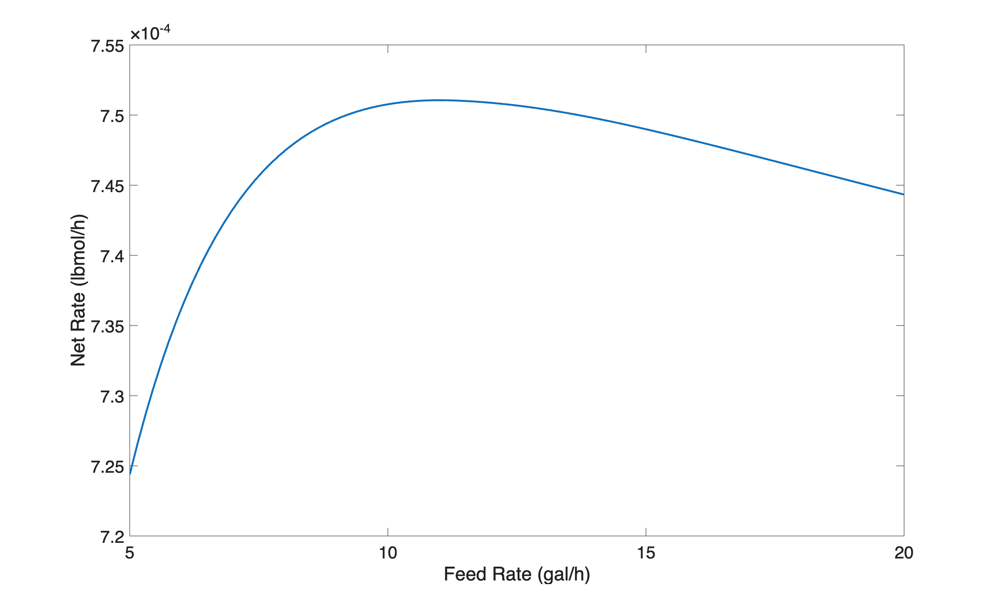

::: {.content-hidden unless-format="pdf"}

```{=latex}
\vspace{-1.5cm}
```

Before summarizing the assignment, the file, `act_20.m`, was created for performing the calculations. Within it a function of the same name was declared. Each of the blocks of code listed below are added to this file to complete the function for performing the calculations.

```matlab
function act_20()
% Calculations for the Class 20 Learning Activity from REB, The Book
```

:::

::: {.content-hidden unless-format="html"}

:::{.callout-tip collapse="true"}
## Click Here to See What an Expert Might be Thinking at this Point

I'll start by reading through the assignment narrative and creating a concise assignment summary. Extensive quantities are specified, so a basis cannot be chosen. I'll use common variables symbols to represent the given quantities, making sure that the symbol I use is consistent with the quantity's units. (nomenclature, e. g. I'll use underlined variable symbols to represent arrays containing more than one value of the variable. I'll use a subscripted "0" to denote initial values and a subscripted "f" to denote final values.) 

(given equations or implicit values such as mole fractions that aren't given and equal zero)

(identification of task type, items of interest needed to make assessment or recommendation)

:::

:::

::: {.content-hidden unless-format="pdf"}

# Assignment Summary

:::

::: {.content-hidden unless-format="html"} 

<center>**Assignment Summary**</center>

:::

[Reactions]{.underline}

$$
A + B \rightarrow D \tag{1}
$$

$$
2 B \rightarrow U \tag{2}
$$

[Rate Expressions]{.underline}

$$
r_1 = k_1C_AC_B \tag{3}
$$

$$
r_2 = k_2C_B^2 \tag{4}
$$

[Reactor]{.underline}: Adiabatic, liquid-phase SBSTR

[Given Constants]{.underline}: $P$ =  1 atm, $V_0$ = 550 gal, $T_0$ = 100 °F, $C_{A,0}$ = 0.015 lbmol gal^–1^, $V_B$ = 2000 gal, $T_{in}$ = 100 °F, $C_{B,in}$ = 0.004 lbmol gal^–1^, $f_{B,min}$ = 0.9, $t_{turn}$ = 30 min, $k_{0,1}$ = 4.193 x 10^11^ gal lbmol^–1^ h^–1^, $E_1$ = 32,400 BTU lbmol^–1^, $\Delta H_1$ = –16,190 BTU lbmol^–1^, $k_{0,2}$ = 6.087 x 10^14^ gal lbmol^–1^ h^–1^, $E_2$ = 36,900 BTU lbmol^–1^, $\Delta H_2$ = –14,030 BTU lbmol^–1^, and $\breve{C}_p$ = 7.2 BTU gal^–1^ °R^–1^.

::: {.content-hidden unless-format="pdf"}

The given and known constants and the basis are converted to consistent units and the given equations are converted to anonymous functions and all are addded to `act_20`. 

```matlab
    % global constants available to all functions
    % given
    P = 1.0; % atm
    V0 = 550.; % gal
    T0 = 100 + 459.7; % °R
    CA0 = 0.015; % lbmol/gal
    VB = 2000.; % gal
    Tin = 100 + 459.7; % °R
    CBin = 0.004; % lbmol/gal
    fB_min = 0.9;
    tTurn = 0.5; % h
    k01 = 4.193e+11; % gal/lbmol/h
    E1 = 32400; % BTU/lbmol
    dH1 = -16190; % BTU/lbmol
    k02 = 6.087e+14; % gal/lbmol/h
    E2 = 36900; % BTU/lbmol
    dH2 = -14030; % BTU/lbmol
    Cp = 7.2; % BTU/gal/°R
    % known
    R = 1.987; % BTU/lbmol/°R
    Rpv = 5.4584; % gal-atm/lbmol/°R
    % calculated
    nA0 = CA0*V0;
```

:::

[Task]{.underline}: Optimization

* Parameter: $\dot{V}$
* Optimization Target: $r_{D,net}$
* Items of Interest: $\dot{V}_{opt}$ and $r_{D,net,max}$

::: {.content-hidden unless-format="pdf"}

# Preliminary Analysis

:::

::: {.content-hidden unless-format="html"}

<center>**Preliminary Analysis**</center>

:::

Ignoring temperature effects, D is only produced in reaction (1). The rate of reaction (1) depends upon the concentrations of both A and B. A only reacts in reaction (1), so maintaining the concentration of A as high as possible will favor production of D. Be reacts in both reactions, and its rate of consumption in the undesired reaction depends more strongly on its concentration that its rate of consumption in the desired reaction. Maintaining the concentration of B as low as possible will disfavor its conversion to the undesired product. Thus, by charging the reactor with A (so its concentration is a high as possible) and slowly adding B (so its concentration is as low as possible) should favor the production of the desired product, D.

::: {.content-hidden unless-format="html"}

:::{.callout-tip collapse="true"}
## Click Here to See What an Expert Might be Thinking at this Point

I'm going to need to solve the SBSTR Design equations to complete this assignment, so I'll start by defining a SBSTR model function. To do that I'll need to 

* generate and simplify the design equations, 
* identify the SBSTR model variables I'll get by solving them, 
* identify any additional computable unknowns they contain and write the equations for calculating them,
* identify any non-computable unknows that will need to be passed to the BSTR model function as arguments, and
* determine the type of equation solver that I'll need and what input it will require.

Mole balances are always needed, and I prefer to write a mole balance for every reagent in the system other than solvent. (discuss simplification)

(reacting fluid energy balance)

(momentum balance)

(exchange fluid energy balance)

(differential ideal gas law - explain why needed)

:::

:::

::: {.content-hidden unless-format="pdf"}

# SBSTR Model Function

:::

::: {.content-hidden unless-format="html"}

<center>**SBSTR Model Function**</center>

:::

[SBSTR Design Equations]{.underline}

$$
\frac{dn_A}{dt} = -r_1V \tag{5}
$$

$$
\frac{dn_B}{dt} = \dot{n}_{B,in} -\left(r_1 + 2 r_2\right)V\tag{6}
$$

$$
\frac{dn_D}{dt} = r_1V\tag{7}
$$

$$
\frac{dn_U}{dt} = r_2V\tag{8}
$$

$$
\frac{dT}{dt} = \frac{-\dot{V}_{in}\breve{C}_p \left(T - T_{in} \right)  - r_1V \Delta H_1 - r_2V \Delta H_2 + P \dot{V}_{in}}{V \breve{C}_p}\tag{9}
$$

$$
\frac{dV}{dt} = \dot{V}_{in}\tag{10}
$$

::: {.content-hidden unless-format="html"}

:::{.callout-tip collapse="true"}
## Click Here to See What an Expert Might be Thinking at this Point

id model variables

id computable unknowns and describe equations

id uncomputable unknowns and note they must be passed as arguments, also note any that are needed for evaluating the residuals or derivatives

:::

:::

[SBSTR Model Variables]{.underline}: $\underline{t}$, $\underline{n}_A$, $\underline{n}_B$, $\underline{n}_D$, $\underline{n}_U$, $\underline{T}$, and $\underline{V}$

[Additional Computable Unknowns]{.underline}: $r_1$, $r_2$, $k_1$, $k_2$, $C_A$, $C_B$, and $\dot{n}_{B,in}$

$$
k_i = k_{0,i} \exp{\left( \frac{-E_i}{RT}  \right)} \qquad i = 1 \text{ and } 2\tag{11}
$$

$$
C_i = \frac{n_i}{V}  \qquad i = A \text{ and } B\tag{12}
$$

$$
\dot{n}_{B,in} = C_{B,in} \dot{V}_{in}\tag{13}
$$

[Uncomputable Unknowns (Received as Arguments)]{.underline}: $\dot{V}_{in}$

$$
\underline{\dot{V}}_{in} = \left[20, \cdots, 40\right] \text{ gal h}^{-1}\tag{14}
$$

(The derivatives function needs $\dot{V}_{in}$, so the SBSTR model function must make it available as a global variable.)

::: {.content-hidden unless-format="html"}

:::{.callout-tip collapse="true"}
## Click Here to See What an Expert Might be Thinking at this Point

id solver needed and list requirements INCLUDING globals

:::

:::

[IVODE Solver Requirements]{.underline}

1.1 Stage 1 initial values

$$
t_{iv} = 0\tag{15}
$$

$$
n_{A,iv} = n_{A,0} = C{A,0} V_0\tag{16}
$$

$$
n_{i,iv} = 0 \qquad i = B, D, \text{ and } U \tag{17}
$$

$$
T_{iv} = T_0\tag{18}
$$

$$
V_{iv} = V_0\tag{19}
$$

2.1 Stage 1 stopping criterion

$$
V = V_f = V_0 + V_B \tag{20}
$$

1.2 (If $\frac{C_{B,in}V - n_{B,f,1}}{C_{B,in}V} < f_{B,min}$) Stage 2 initial values

$$
t_{iv} = t_{1,f} \tag{21}
$$

$$
n_{i,iv} = n_{i,f,1} \qquad i = A, B, D, \text{ and } U \tag{22}
$$

$$
T_{iv} = T_{1,f} \tag{23}
$$

$$
V_{iv} = V_{1,f} \tag{24}
$$

2.2 (If $\frac{C_{B,in}V - n_{B,f,1}}{C_{B,in}V} < f_{B,min}$) Stage 2 stopping criterion

$$
n_B = V_B C_{B,in} \left(1 - f_{B,min} \right) \tag{25}
$$

3. SBSTR derivatives function that

    a. receives the independent and dependent variables ($t$, $n_A$, $n_B$, $n_D$, $n_U$, $T$, and $V$) at the start of an integration step

    b. can access the current value of $\dot{V}_{in}$

    c. calculates the additional unknowns using equations (3), (4), (11), (12), and (13)

    d. evaluates and returns the SBSTR design equation derivatives using equations (5) through (10).

::: {.content-hidden unless-format="pdf"}

To facilitate making $\dot{V}_{in}$ available to the SBSTR derivatives function, the global variable, `g_Vdot` is declared and set to `nan` initially. Then the SBSTR model and derivatives functions are added to `act_20`.

```matlab
    % global variable for the current volumetric flow rate
    g_Vdot = nan;

    % SBSTR reactor function
    function [t, nA, nB, nD, nU, T, V] = sbstr_model_variables(Vdot)
        % set the volumetric flow rate for stage 1
        g_Vdot = Vdot;

        % set the initial values for the first stage
        ind_0 = 0;
        dep_0 = [nA0, 0, 0, 0, T0, V0];

        % set the stopping criterion
        stopVar = 6;
        stopVal = V0 + VB;

        % solve the design equations for stage 1
        odes_are_stiff = false;
        [t, dep, success, message] = solve_ivodes(ind_0, dep_0, stopVar...
            , stopVal, @sbstr_derivatives, odes_are_stiff);
        
        % extract the individual dependent variables
        nA = dep(:,1);
        nB = dep(:,2);
        nD = dep(:,3);
        nU = dep(:,4);
        T = dep(:,5);
        V = dep(:,6);
        
        % check for solver issues
        if ~success
            disp('')
            disp(["SBSTR Model stage 1 issue: ", message])
            disp('Press any key to continue or CTRL-C to exit')
            pause
        end
        
        % calculate the conversion of B during stage 1
        fB1 = 100*(VB*CBin - nB(end))/(VB*CBin);

        % if the conversion is below 90% continue with stage 2
        if fB1 < 90
            
            % set the volumetric flow rate for stage 2
            g_Vdot = 0;

            % set the initial values equal to the final values from stage 1
            ind_0 = t(end);
            dep_0 = [nA(end), nB(end), nD(end), nU(end), T(end), V(end)];

            % set the stopping criterion for stage 2
            stopVar = 2;
            stopVal = VB*CBin*(1 - fB_min);
            
            % solve the design equations for stage 2
            odes_are_stiff = false;
            [t2, dep, success, message] = solve_ivodes(ind_0, dep_0, stopVar...
                , stopVal, @sbstr_derivatives, odes_are_stiff);
            
            % combine the results for the two stages
            t = [t; t2];
            nA = [nA; dep(:,1)];
            nB = [nB; dep(:,2)];
            nD = [nD; dep(:,3)];
            nU = [nU; dep(:,4)];
            T = [T; dep(:,5)];
            V = [V; dep(:,6)];
            
            % check for solver issues
            if ~success
                disp('')
                disp(["SBSTR Model stage 2 issue: ", message])
                disp('Press any key to continue or CTRL-C to exit')
                pause
            end
        end
    end

    % SBSTR derivatives function
    function ddt = sbstr_derivatives(~, dep)
        % Extract the dependent variables
        nA = dep(1);
        nB = dep(2);
        T = dep(5);
        V = dep(6);

        % calculate the additional unknowns
        k1 = k01 * exp(-E1/(R*T));
        k2 = k02 * exp(-E2/(R*T));
        CA = nA / V;
        CB = nB / V;
        r1 = k1 * CA * CB;
        r2 = k2 * CB^2;
        nB_in = g_Vdot * CBin;
        
        % Calculate the derivatives
        dnAdt = -V*r1;
        dnBdt = nB_in - V*(r1 + 2*r2);
        dnDdt = V*r1;
        dnUdt = V*r2;
        dTdt = (-g_Vdot*Cp*(T-Tin)-V*r1*dH1 -V*r2*dH2 + P*g_Vdot*R/Rpv)/V/Cp;
        dVdt = g_Vdot;
        
        % return the derivatives as a column vector
        ddt = [dnAdt; dnBdt; dnDdt; dnUdt; dTdt; dVdt];
    end
```

:::

::: {.content-hidden unless-format="html"}

:::{.callout-tip collapse="true"}
## Click Here to See What an Expert Might be Thinking at this Point

At this point I have functions that can be used to solve the SBSTR design equations and get (list of variables and additional unknowns). The last function I need is an items of interest function that does that and then uses the results to calculate (list of items of interest that depend upon them).

:::

:::

::: {.content-hidden unless-format="pdf"}

# Items of Interest Function

:::

::: {.content-hidden unless-format="html"}

<center>**Items of Interest Function**</center>

:::

1. define the range of values of $\dot{V}_{in}$, equation (14)
2. loop through that range of values
    a. calling the SBSTR model function for each one to get $\underline{t}$ and $\underline{n}_D$ and
    b. calculating and saving the corresponding net rate

$$
r_{D,net}=\frac{n_{D,f,2}}{t_{f,2} + t_{turn}} \Bigg|_{\dot{V}_{in}} \tag{26}
$$

3. determine the maximum net rate and the corresponding volumetric flow rate

$$
r_{D,net,max} = \max{\left(\underline{r}_{D,net}\right)}\tag{27}
$$

$$
\dot{V}_{opt} = \underset{\dot{V}_{in}}{\arg\max}\left( \underline{r}_{D,net} \right) \tag{28}
$$

4. show, and save the results.

::: {.content-hidden unless-format="pdf"}

To complete `act_20`, the items of interest function was added along with a line of code to call it and perform the calculations.

```matlab
    % items of interest function
    function items_of_interest()
        % set a range of values for the volumetric flow rate
        %Vdot_range = linspace(20, 40, 100)
        Vdot_range = linspace(5, 20, 100); % narrow the range

        % allocate storage for the corresponding net rates
        rNet = ones(100,1)*nan;

        % for each value of the volumetric flow rate
        for i = 1:100
            % solve the design equations
            [t, ~, ~, nD, ~, ~, ~] = sbstr_model_variables(Vdot_range(i));

            % calculate and save the corresponding net rate
            rNet(i) = nD(end)/(t(end) + tTurn);
        end
        
        % find the index of the maximum net rate and corresponding Vdot
        [max_rNet, iMax] = max(rNet);
        Vdot_opt = Vdot_range(iMax);
        
        % tabulate, show and save the results
        item = ["Optimum Feed Rate"; "Net Rate"];
        value = [Vdot_opt; max_rNet];
        units = ["gal/h"; "lbmol/h"];
        resultsTable = table(item, value, units);
        disp('')
        disp(resultsTable)
        disp('')
        writetable(resultsTable, 'act_20_results.csv')

        % plot the net rate vs. the feed rate
        figure
        plot(Vdot_range, rNet, 'LineWidth', 2)
        xlabel('Feed Rate (gal/h)', 'FontSize', 18)
        ylabel('Net Rate (lbmol/h)','FontSize', 18)
        set(gca,'FontSize', 18)
        saveas(gcf,'act_20_rNet_vs_VFR.png')
    end

    % perform the calculations
    items_of_interest()
end
```

:::

::: {.content-hidden unless-format="html"}

<center>**Implementation of the Calculations.**</center>

 Computer code to perform the calculations can be written using a variety of programming languages and environments, and the actual code can be structured in a variety of ways. Referring to the preceding assignment summary, computational strategy and formulation of the equations, here are the essential things it must do.

1. 
2. 

One way to structure the code, based on the preceding workup, is to write a single master function for the assignment. Within it declare the given constants as global constants and the given equations as anonymous functions. (Then declare the global variables to make (symbol) available to the residuals/derivatives function.) Define the BSTR model function, the BSTR derivatives function, the coupled unknowns residual function, and the items of interest function. Then call the items of interest function.

:::

::: {.content-hidden unless-format="pdf"}

# Results

:::

::: {.content-hidden unless-format="html"}

<center>**Results**</center>

:::

::: {.content-hidden unless-format="pdf"}

The calculations were performed by calling the function, `act_20`. The range of values of $\dot{V}_{in}$ was made narrower so the maximum could be more accurately determined. The results are shown below and in @fig-r_vs_Vdot.

```matlab
>> act_20
           item              value         units  
    ___________________    __________    _________

    "Optimum Feed Rate"        11.061    "gal/h"  
    "Net Rate"             0.00075106    "lbmol/h"
```

{#fig-r_vs_Vdot width="70%"}

:::

::: {.content-hidden unless-format="html"}

The calculations were performed as described above. (discuss any issues) (present the results)

:::

::: {.content-hidden unless-format="pdf"}

# Discussion

:::

::: {.content-hidden unless-format="html"}

<center>**Discussion**</center>

:::

The instantaneous selectivity is the rate of production of the desired product to that of the undesired product. For this system, the selectivity for D over U is given in equation (29). It clearly shows that high concentration of A and low concentration of B give the highest instantaneous selectivity. That is why the reactor is initially filled with A (to keep its concentration as high as possible) and B is added to it slowly (so it reacts nearly as fast as it is added and its concentration stays small).

$$
S_{D/U,inst} = \frac{k_1}{k_2} \frac{C_A}{C_B}
\tag{29}
$$

Operating in that way introduces a trade-off between reaction rate and selectivity. A low concentration of B offers high selectivity, but it also results in both reaction rates being small. At the two ends of the spectrum, the rate at which D is produced is low. At low concentration of B it is produced very selectively, but at a very low rate. At high concentration of B, the rate is very high, but a large amount of U is being produced instead of D.

This can be seen by examination of the expression for the net rate of production of D, equation (30). Operation at low concentration of B produces a large amount of D, but requires a long processing time to do so. Operating at high concentration of B requires a short processing time, but also reduces the amount of D that is generated. Put differently, increasing the feed rate decreases both the numerator and the denominator in equation (30). At low feed rates the decrease in the denominator predominates and the net rate increases. At high feed rates, the numerator predominates and the rate decreases. The maximum net rate of production occurs at the feed rate where the change in the numerator and denominator are equal.

$$
r_{D,net}=\frac{n_{D,f}}{t_{f} + t_{turn}} \tag{30}
$$

::: {.content-hidden unless-format="pdf"}

# Summary

:::

::: {.content-hidden unless-format="html"}

<center>**Summary**</center>

:::

The maximum net rate of production of reagent D is 7.51 x 10^–4^ lbmol h^–1^, and it occurs when the volumetric feed rate is 11.1 gal h^–1^.
