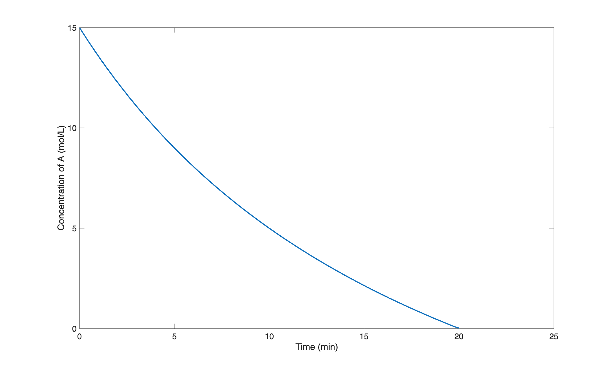
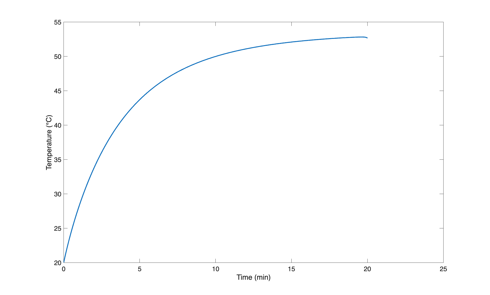

::: {.content-hidden unless-format="pdf"}

```{=latex}
\vspace{-1.5cm}
```

Before summarizing the assignment, the file, `ex_8_4_1.m`, was created for performing the calculations. Within it a function of the same name was declared. Each of the blocks of code listed below are added to this file to complete the function for performing the calculations.

```matlab
function ex_8_4_1()
% Calculations for Example 8.4.1 in "Reaction Engineering Basics, The Book"
```

# Assignment Summary

:::

::: {.content-hidden unless-format="html"}

:::{.callout-tip collapse="true"}
## Click Here to See What an Expert Might be Thinking at this Point

I'll start by reading through the assignment narrative and creating a concise assignment summary. The assignment specifies extenisve quantities, so I cannot choose a basis for the calculations. I'll use common variables symbols to represent the given quantities, making sure that the symbol I use is consistent with the quantity's units. I'll use underlined variable symbols to represent arrays containing more than one value of the variable, a subscripted "0" to denote initial values, a subscripted "f" to denote final values, and a subscripted "in" to denote inlet values. Flow variables for outlet quantities will not have a subscript. I'll use a subscripted "iv" to denote an initial value of an IVODE variable.

The assignment involves a parametric analysis, but the parameter is the reaction time, which is the independent variable in the BSTR model. So the parametric analysis can be performed by solving the BSTR design equations once. The final time is not specified, so I'll need to choose a value and generate the requested graphs. If the plotted quantities are still changing at the final time, I'll need to increase the final time and repeat the calculations.

:::

<center>**Assignment Summary**</center>

:::

[Reaction]{.underline}

$$
A + B \rightarrow S + W \tag{1}
$$

[Rate Expression]{.underline}

$$
r_1 = k_1C_AC_B \tag{2}
$$

[Reactor]{.underline}: Non-adiabatic, liquid-phase SBSTR

[Given Constants]{.underline}: $C_{A,0}$ = 15 M, $T_0$ = 20 °C, $C_{B,in}$ = 15 M, $T_{in}$ = 20 °C, $V$ = 10 L, $V_A$ = 5.0 L, $\dot{V}_{in}$ = 0.25 L min^–1^, $V_B$ = 5 L, $V_{ex}$ = 2.5 L, $T_{ex,in}$ = 20 °C, $\dot{V}_{ex,in}$ = 2.5 L min^–1^, $A_{ex}$ = 2150 cm^2^ , $U$ = 73 cal cm^2^ h^–1^ K^–1^, $T_{ex,0}$ = 20 °C, $\tilde{C}_p$ = $\tilde{C}_{p,ex}$ = 1 g cm^–3^, $\rho$ = $\rho_{ex}$ = 1 cal g^–1^ K^–1^, $\Delta H_1$ = –13.7 kcal mol^–1^, $k_{0,1}$ = 8.11 x 10^12^ L mol^–1^ s^–1^, $E_1$ = 17.7 kcal mol^–1^, and $P$ = 1 atm.

::: {.content-hidden unless-format="pdf"}

The given and known constants were converted to consistent units and addded to `example_8_4_1`. 

```matlab
    % global constants available to all functions
    % given
    CA_0 = 15.0; % mol/L
    T_0 = 20 + 273.15; % K
    CB_in = 15.0; % mol/L
    T_in = T_0;
    V_0 = 5.0; % L
    Vdot_in = 0.25/60; % L/s
    V_B = 5.0; % L
    V_ex = 2.5; % L
    Tex_in = 20 + 273.15; % K
    Vdot_ex = 2.5/60; % L/s
    A = 2150; % cm^2
    U = 73/60/60; % cal/cm^2/s/K
    Tex_0 = 20 + 273.15; % K
    rho = 1000.0; % g/L
    Cp = 1.0; % cal/g/K
    dH_1 = -13700.0; % cal/mol
    k0_1 = 8.11E12; % L/mol/s
    E_1 = 17700.0; % cal/mol
    P = 1.0; % atm
    % known
    Re = 1.987; % cal/mol/K
    Rw = 0.08206; % L-atm/mol/K
    % calculated
    nDotB_in = Vdot_in*CB_in;
    nA_0 = CA_0*V_0;
    mDot_ex = Vdot_ex*rho;
    V_f = V_0 + V_B;
```

:::

[Task]{.underline}: Parametric analysis

* [Parameter]{.underline}: $t$
* [Items of Interest]{.underline}: $\underline{C}_A$ and $\underline{T}$ *vs.* $\underline{t}$ as graphs 

::: {.content-hidden unless-format="pdf"}

# Preliminary Analysis

:::

::: {.content-hidden unless-format="html"}

<center>**Preliminary Analysis**</center>

:::

The assignment narrative suggests that the reaction is very fast. If it is effectively instantaneous, the base will be completely converted upon addition to the reactor. In that case, the concentration of acid will decrease at essentially the same rate as the rate at which the base is added. If the reaction is fast, but not instantaneous, the concentration of acid will decrease at a rate that is less than the rate at which the base is added.

In either case, the temperature change will be determined by the relative rates of heat generation and heat removal. Thus, even if the reaction is effectively instantaneous, the temperature of the reacting fluid will not increase linearly due to the heat removal by the cooling fluid.

::: {.content-hidden unless-format="html"}

:::{.callout-tip collapse="true"}
## Click Here to See What an Expert Might be Thinking at this Point

I'm going to need to solve the SBSTR Design equations to complete this assignment, so I'll start by defining an SBSTR model function. To do that I'll need to 

* generate and simplify the design equations, 
* identify the SBSTR model variables I'll get by solving them, 
* identify any additional computable unknowns they contain and write the equations for calculating them,
* identify any non-computable unknows that will need to be passed to the BSTR model function as arguments, and
* determine the type of equation solver that I'll need and what input it will require.

Mole balances must always be included among the design equations, and I'll write one for each reagent present in the system. Assuming that the solutions are aqueous, I won't write a mole balance for the solvent, W. Only one reaction is taking place, so the summation reduces to a single term, and only reagent B flows into the reactor, so $\dot n_{A,in}$ = $\dot n_{S,in}$ = 0.

$$
\frac{dn_i}{dt} = \dot n_{i,in} + V \sum_j \nu_{i,j}r_j \Rightarrow \dot n_{i,in} + \nu_{i,1} V r_1
$$

The reactor is not isothermal, so an energy balance on the reaction fluid, @eq-sbstr_energy_bal, must also be included among the reactor design equations. The assignment narrative provides the gravimetric heat capacity of the reacting fluid, so that can be used in the first term in place of the summation over the molar heat capacities. The reacting fluid is an ideal liquid, so the pressure is constant and its time deriviative is equal to zero. Liquid is being added to the reactor, so the reacting fluid volume is not constant and its derivative is not equal to zero. Apart from an agitator which can be assumed to do negligible work, there are no shafts or moving boundaries, so the rate of doing work is zero. The term for the sensible heat gained by the B that is fed to the reactor is expressed in terms of its molar flow rate and heat capacity. This term can be re-written in terms of the mass flow rate and heat capacity, and noting that the heat capacity is constant, it can be taken outside of the integral which then can be evaluated. Finally, there is only one reaction taking place so the final sum reduces to a single term.

$$
\begin{aligned}
\cancelto{\rho V \tilde{C}_p}{\sum_i \left( n_i \hat C_{p,i}\right)}  \frac{dT}{dt} &- \cancelto{0}{V\frac{dP}{dt}} - P\frac{dV}{dt} = \dot Q - \cancelto{0}{\dot W} \\&- \cancelto{\dot{m}_{B,in}\tilde{C}_p \left(T - T_{in}\right)}{\sum_i \dot n_{i,in} \int_{T_{in}}^T \hat C_{p,i}dT}  - \cancelto{Vr_1 \Delta H_1}{V\sum_j r_j \Delta H_j}
\end{aligned}
$$

$$
\rho V \tilde{C}_p \frac{dT}{dt} - P\frac{dV}{dt} = \dot Q - \rho \dot{V}_{in} \tilde{C}_p\left(T - T_{in}\right)  - V r_1 \Delta H_1
$$

The reactor is cooled using a heat exchange fluid that gains sensible heat. The temperature of the exchange fluid is not known and constant, so an energy balance on it, @eq-exchange_energy_bal_sensible, is also needed. Again, because the heat capacity is constant it can be taken outside of the integral, and the integral can be evaluated.

$$
\rho_{ex} V_{ex} \tilde C_{p,ex}\frac{dT_{ex}}{dt} = -\dot Q - \dot m_{ex} \int_{T_{ex,in}}^{T_{ex}} \tilde C_{p,ex}dT = -\dot Q - \dot m_{ex} \tilde C_{p,ex} \left( T_{ex} - T_{ex,in} \right)
$$

For an ideal liquid solution, the rate of change of the fluid volume within the reactor equals the net inlet volumetric flow rate because there is no $Delta V$ of mixing. I have two options for handling the time derivative of the volume. One is to add another design equation.

$$
\frac{dV}{dt} = \dot{V}_{in}
$$

That's the option I'm going to use. The other option is to replace $\frac{dV}{dt}$ in the energy balance with $\dot{V}_{in}$ and then to integrate the differential equation above to get an analytical expression that can be used to calculate $V$ when it is needed.

:::

:::

::: {.content-hidden unless-format="pdf"}

# SBSTR Model Function

:::

::: {.content-hidden unless-format="html"}

<center>**SBSTR Model Function**</center>

:::

[SBSTR Design Equations]{.underline}

$$
\frac{dn_A}{dt} = - V r_1 \tag{3}
$$

$$
\frac{dn_B}{dt} = \dot n_{B,in} - V r_1 \tag{4}
$$

$$
\frac{dn_S}{dt} =  V r_1 \tag{5}
$$

$$
\rho V \tilde{C}_p \frac{dT}{dt} - P\frac{dV}{dt} = \dot Q - \rho \dot{V}_{in} \tilde{C}_p\left(T - T_{in}\right)  - V r_1 \Delta H_1 \tag{6}
$$

$$
\rho_{ex} V_{ex} \tilde C_{p,ex}\frac{dT_{ex}}{dt} = -\dot Q - \dot m_{ex} \int_{T_{ex,in}}^{T_{ex}} \tilde C_{p,ex}dT = -\dot Q - \dot m_{ex} \tilde C_{p,ex} \left( T_{ex} - T_{ex,in} \right) \tag{7}
$$

$$
\frac{dV}{dt} = \dot{V}_{in} \tag{8}
$$

::: {.content-hidden unless-format="html"}

:::{.callout-tip collapse="true"}
## Click Here to See What an Expert Might be Thinking at this Point

The design equations are IVODEs, so solving them will yield corresponding sets of values of the independent variable, $t$, and the dependent variables, $n_A$, $n_B$, $n_S$, $T$, $T_{ex}$, and $V$. In order to solve them numerically (see @sec-apxd) I'll need to write a derivatives function that receives these quantities at the start of an integration step and returns the corresponding derivatives of the dependent variables with respect to $t$.

Before the derivatives in equations (3) through (8) can be evaluated, any additional unknowns appearing in them must be calculated. Going through those equations variable-by-variable I see that $r_1$, $\dot{n}_{B,in}$, $\dot{Q}$, and $\dot{m}_{ex}$ are unknown. The rate can be calculated using the given rate expression, equation (2), but that introduces $k_1$, $C_A$, and $C_B$ as additional unknowns. The Arrhenius expression can be used to calculate the rate coefficient, and the concentrations can be calculated using the defining equation for concentration.

The inlet molar flow of B can be calculated from the inlet volumetric flow rate and concentration of B. The rate of heat transfer can be calculated using the heat transfer area and coefficient, and the mass flow rate of the exchange fluid from its volumetric flow rate and density.

:::

:::

[SBSTR Model Variables]{.underline}: $\underline{t}$, $\underline{n}_A$, $\underline{n}_B$, $\underline{n}_S$, $\underline{T}$, $\underline{T}_{ex}$, and $\underline{V}$.

[Additional Computable Unknowns]{.underline}: $r_1$, $k_1$, $C_A$, $C_B$, $\dot{n}_{B,in}$, $\dot{Q}$, and $\dot{m}_{ex}$.

$$
k_1 = k_{0,1}\exp{\left(\frac{-E_1}{RT}\right)} \tag{10}
$$

$$
C_i = \frac{n_i}{V} \qquad i = A \text{ and } B \tag{11}
$$

$$
\dot{n}_{B,in} = \dot{V}_{in} C_{B,in} \tag{12}
$$

$$
\dot{Q} = UA_{ex}\left(T_{ex} - T \right) \tag{13}
$$

$$
\dot{m}_{ex} = \rho \dot{V}_{ex} \tag{14}
$$

[IVODE Solver Requirements]{.underline}

::: {.content-hidden unless-format="html"}

:::{.callout-tip collapse="true"}
## Click Here to See What an Expert Might be Thinking at this Point

The design equations are IVODEs, so I'll need to call an IVODE solver. IVODE solvers require initial values, a stopping criterion and a derivatives function.

I can define $t=0$ as the instant the flow of B into the reactor begins. The initial values are then simply the values of the dependent variables at that time. At that instant, only reagent A is present in the system, so the initial values of the molar amounts of B and S are zero, $T_0$ and $T_{ex,0}$ are given, and the entire volume of acid is present in the reactor. The initial molar amount of A can be calculated from the known initial reacting fluid volume and the initial concentration of A.

When 5 L of the base solution have been added, the feed stops. Assuming the reacting fluid to be an ideal solution, the final volume will then equal the initial volume of acid in the reactor plus the volume of base added to it. This can be used to define the stopping criterion.

The derivatives function I provide must return the values of the individual derivatives. To do that, I need to write the design equations in the form of derivative expressions. All but one of them contains a single derivative. I could use linear algebra to calculate the derivatives, but it's easier just to substitute $\dot{V}_{in}$ for the derivative of the volume in the energy balance and then rearrange the two energy balances in the form of derivative expressions.

:::

:::

1. Initial values

$$
t_{iv} = 0 \tag{15}
$$

$$
n_{A,iv} = C_{A,0} V_A \tag{16}
$$

$$
n_{B,iv} = 0 \tag{17}
$$

$$
n_{S,iv} = 0 \tag{18}
$$

$$
T_{iv} = T_0 \tag{19}
$$

$$
T_{ex,iv} = T_{ex,0} \tag{20}
$$

$$
V_{iv} = V_A \tag{21}
$$

2. Stopping criterion

$$
V = V_f = V_A + V_B \tag{22}
$$

3. SBSTR derivatives function that

    a. receives the independent and dependent variables ($t$, $n_A$, $n_B$, $n_S$, $T$, $T_{ex}$, and $V$) at the start of an integration step as arguments

    b. calculates the additional unknowns using equations (2) and (10) through (14)

    d. evaluates and returns the SBSTR design equation derivatives using equations (3) through (5), (8), (23), and (24).

$$
\frac{dT}{dt} = \frac{\dot Q - \rho \dot{V}_{in} \tilde{C}_p\left(T - T_{in}\right)  - V r_1 \Delta H_1 + P\dot{V}_{in}}{\rho V \tilde{C}_p} \tag{23}
$$

$$
\frac{dT_{ex}}{dt} = \frac{-\dot Q - \dot m_{ex} \tilde C_p \left( T_{ex} - T_{ex,in} \right)}{\rho V_{ex} \tilde C_p} \tag{24}
$$

::: {.content-hidden unless-format="pdf"}

The SBSTR model and SBSTR derivatives functions were added to `example_8_4_1`.

```matlab
    % SBSTR reactor function
    function [t, nA, nB, nS, T, Tex, V] = sbstr_model_variables()
        % set the initial values
        ind_0 = 0.0;
        dep_0 = [nA_0, 0.0, 0.0, T_0, Tex_0, V_0];

        % define the stopping criterion
        stopVar = 6;
        stopVal = V_f;
        
        % solve the IVODEs
        odes_are_stiff = false;
        [t, dep, success, message] = solve_ivodes(ind_0, dep_0, stopVar...
            , stopVal, @sbstr_derivatives, odes_are_stiff);

        % check for solver issues
        if ~success
            disp('')
            disp(["SBSTR function issue: ", message])
            disp(' Press any key to continue or Ctrl-C to exit')
            pause
        end

        % extract the dependent variables
        nA = dep(:,1);
        nB = dep(:,2);
        nS = dep(:,3);
        T = dep(:,4);
        Tex = dep(:,5);
        V = dep(:,6);
    end

    % SBSTR derivatives function
    function ddt = sbstr_derivatives(~, dep)
        % extract the dependent variables
        nA = dep(1);
        nB = dep(2);
        T = dep(4);
        Tex = dep(5);
        V = dep(6);

        % calculate the additional unknowns
        k_1 = k0_1*exp(-E_1/Re/T);
        CA = nA/V;
        CB = nB/V;
        r = k_1*CA*CB;
        Qdot = U*A*(Tex - T);

        % evaluate the derivatives
        dnAdt = -V*r;
        dnBdt = nDotB_in -V*r;
        dnSdt = V*r;
        dTdt = (Qdot - rho*Vdot_in*Cp*(T - T_in) - V*r*dH_1 ...
            + P*Vdot_in*Re/Rw) /(rho*V*Cp);
        dTexdt = (-Qdot - mDot_ex*Cp*(Tex - Tex_in))/(rho*V_ex*Cp);
        dVdt = Vdot_in;

        % return the derivatives as a column vector
        ddt = [dnAdt; dnBdt; dnSdt; dTdt; dTexdt; dVdt];
    end
```

:::

::: {.content-hidden unless-format="html"}

:::{.callout-tip collapse="true"}
## Click Here to See What an Expert Might be Thinking at this Point

At this point I have functions that can be used to solve the SBSTR design equations and get $\underline{t}$, $\underline{n}_A$, $\underline{n}_B$, $\underline{n}_S$, $\underline{T}$, $\underline{T}_{ex}$, and $\underline{V}$. The last function I need is an items of interest function that does that and then uses the results to calculate $\underline{C}_A$ and generate the requested graphs.

:::

:::

::: {.content-hidden unless-format="pdf"}

# Items of Interest Function

:::

::: {.content-hidden unless-format="html"}

<center>**Items of Interest Function**</center>

:::

1. Call the SBSTR model function to get $\underline{t}$, $\underline{n}_A$, $\underline{n}_B$, $\underline{n}_S$, $\underline{T}$, $\underline{T}_{ex}$, and $\underline{V}$.
2. Calculate $\underline{C}_A$.

$$
\underline{C}_A = \frac{\underline{n}_A}{\underline{V}} \tag{25}
$$

3. Convert units as desired and generate the requested graphs.

::: {.content-hidden unless-format="pdf"}

To complete `example_8_4_1`, the items of interest function was added along with a line of code to call it and perform the calculations.

```matlab
    % items_of_interest function
    function items_of_interest()
        % solve the reactor design equations
        [t, nA, ~, ~, T, ~, V] = sbstr_model_variables();

        % calculate the items of interest for plotting and convert units
        CA = nA./V;
        T_C = T - 273.15;
        t_min = t/60;

        % tabulate, show and save the final concentration and temperature
        item = ["Final Concentration of A"; "Final Temperature"];
        value = [CA(end); T_C(end)];
        units = ["M"; "°C"];
        resultsTable = table(item, value, units);
        disp('')
        disp(resultsTable)
        disp('')
        writetable(resultsTable, 'ex_8_4_1_results.csv')
        
        % display and save the graphs
        figure
        plot(t_min, CA, 'LineWidth', 2)
        xlabel("Time (min)", "FontSize", 14)
        ylabel("Concentration of A (mol/L)", "FontSize", 14)
        set(gca, 'FontSize', 14)
        saveas(gcf, 'ex_8_4_1_CA_vs_t.png')

        figure
        plot(t_min, T_C, "LineWidth", 2)
        xlabel("Time (min)", "FontSize", 14)
        ylabel("Temperature (°C)", "FontSize", 14)
        set(gca, 'FontSize', 14)
        saveas(gcf, 'ex_8_4_1_T_vs_t.png')
    end

    % perform the calculations
    items_of_interest()
end
```

:::

::: {.content-hidden unless-format="html"}

<center>**Implementation of the Calculations.**</center>

Computer code to perform the calculations can be written using a variety of programming languages and environments, and the actual code can be structured in a variety of ways. Referring to the preceding assignment summary, computational strategy and formulation of the equations, here are the essential things it must do.

1. Make the given and known constants available wherever they are needed.
2. Define the derivatives function.
3. Define the initial values and stopping criterion.
4. Call an IVODE solver
	a. pass the initial values, stopping criterion and derivatives function as arguments, and
	b. receive corresponding sets of values of the reactor model variables spanning the interval during which base was being added to the reactor.
5. Calculate corresponding values of the concentration of acid during that interval.
6. Generate the requested graphs.

One way to structure the code, based on the preceding workup, is to write a single master function for the assignment. Within it declare the given constants as global constants (in consistent units), define the BSTR model, the BSTR derivatives, and  items of interest functions, and then call the items of interest function.

:::

::: {.content-hidden unless-format="pdf"}

# Results

:::

::: {.content-hidden unless-format="html"}

<center>**Results**</center>

:::

::: {.content-hidden unless-format="pdf"}

The calculations were performed by calling the function, `example_8_4_1`, and no solver issues were encountered.

The acid concentration as a function of reaction time is shown in @fig-ch8_ex1_CA_vs_t. The temperature of the reacting fluid as a function of reaction time is shown in @fig-ch8_ex1_T_vs_t.

{#fig-ch8_ex1_CA_vs_t width="70%"}

{#fig-ch8_ex1_T_vs_t width="70%"}

:::

::: {.content-hidden unless-format="html"}

The calculations were performed as described above, and no solver issues were encountered.

The acid concentration as a function of reaction time is shown in @fig-ch8_ex1_CA_vs_t. The temperature of the reacting fluid as a function of reaction time is shown in @fig-ch8_ex1_T_vs_t.

{#fig-ch8_ex1_CA_vs_t width="70%"}

{#fig-ch8_ex1_T_vs_t width="70%"}

:::

::: {.content-hidden unless-format="pdf"}

# Discussion

:::

::: {.content-hidden unless-format="html"}

<center>**Discussion**</center>

:::

The rate of decrease of the acid concentration is not linear. As noted in the preliminary analysis, this suggests that while the reaction is fast, it is not instantaneous. As a consequence there are three factors affecting the instantaneous reaction rate: the concentration of acid, the concentration of base, and the temperature of the reacting fluid. The curvature in the graphs results from the effect of the concentraion of acid upon the rate.

::: {.content-hidden unless-format="pdf"}

# Summary

:::

::: {.content-hidden unless-format="html"}

<center>**Summary**</center>

:::

The concentration and temperature profiles during the addition of the base to the SBSTR are shown in @fig-ch8_ex1_CA_vs_t and @fig-ch8_ex1_T_vs_t, respectively. At the instant the addition of the base to the reactor is completed, the concentration of acid is less than 0.02 M and the temperature of the reacting fluid is 52.7 °C
