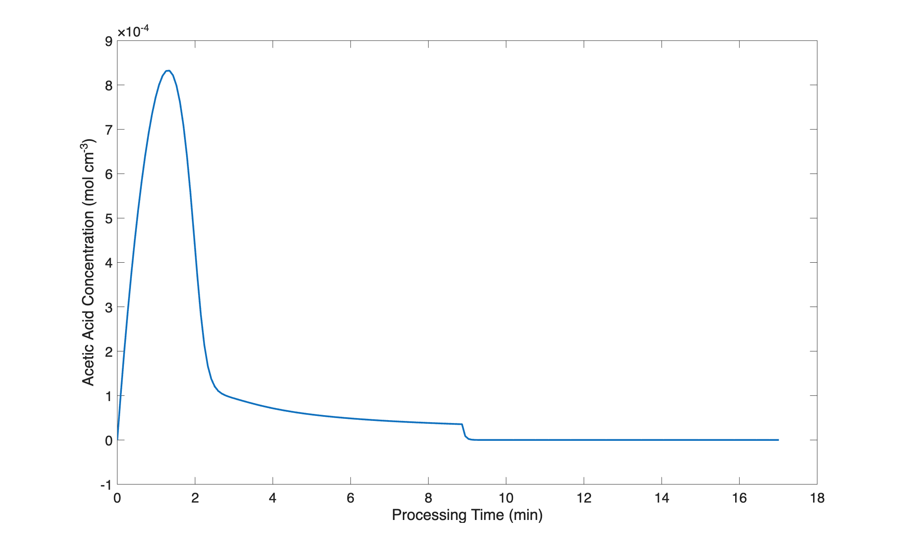
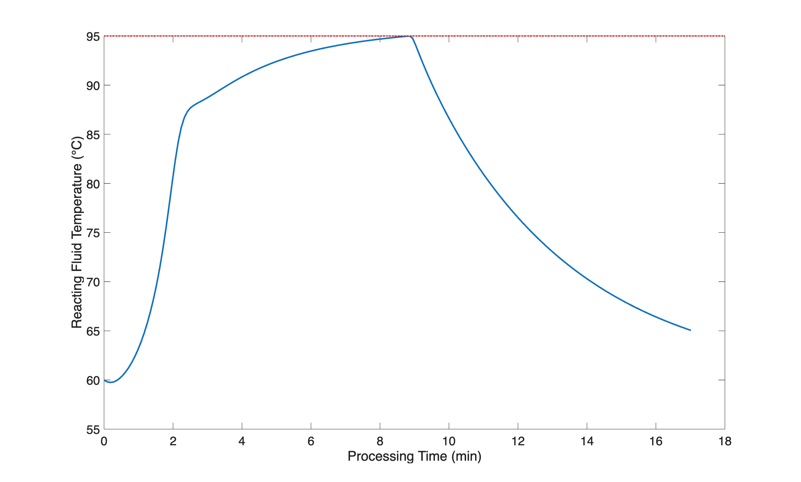

::: {.content-hidden unless-format="pdf"}

```{=latex}
\vspace{-1.5cm}
```

Before summarizing the assignment, the file, `ex_8_4_3.m`, was created for performing the calculations. Within it a function of the same name was declared. Each of the blocks of code listed below are added to this file to complete the function for performing the calculations.

```matlab
function ex_8_4_3()
% Calculations for Example 8.4.3 from REB, The Book
```

:::

::: {.content-hidden unless-format="html"}

:::{.callout-tip collapse="true"}
## Click Here to See What an Expert Might be Thinking at this Point

I'll start by reading through the assignment narrative and creating a concise assignment summary. Several extensive quantities are provided, so a basis cannot be chosen. I'll use common variables symbols to represent the given quantities, making sure that the symbol I use is consistent with the quantity's units. I'll use subscripted 0 to denote initial values, "in" to denote inlet values, and "opt" to denote that optimum value. Later in the analysis, I'll use a vertical bar with a subscripted $dot{V}_{opt"}$ to indicate values calculated using the optimum feed rate. For example, $\underline{n}_A\big|_{\dot{V}_{opt}}$ would indicate the set of values of $n_A$ found by solving the design equations using the optimum feed rate.

The assignment narrative describes an SBSTR that is cooled by transferring sensible heat to cooling water in the reactor jacket. It asks for the volumetric feed rate that will minimize the processing time, subject to a constraint on the maximum temperature, so the assignment involves an optimization task.

:::

:::

::: {.content-hidden unless-format="pdf"}

# Assignment Summary

:::

::: {.content-hidden unless-format="html"} 

<center>**Assignment Summary**</center>

:::

[Reaction]{.underline}

$$
A + W \rightarrow 2 Z \tag{1}
$$

[Rate Expression]{.underline}

$$
r_1 = k_1C_A \tag{2}
$$

[Reactor]{.underline}: Non-adiabatic, liquid-phase SBSTR with a 2 stage operational protocol

&nbsp;

[Given Constants]{.underline}: $k_{0,1}$ = 1.192 x 10^15^ min^-1^, $E_1$ =  97,600 J mol^-1^, $\Delta H_1$ = -58,615 J mol^-1^, $V_{ex}$ = 300 cm^3^, $T_{ex,in}$ = 60 °C, $\dot{V}_{ex,in}$ = 250 cm^3^ min^-1^ $UA$ = 260 cal min^-1^ K^-1^, $P$ = 1 atm, $V_{W,0}$ = 67 cm^3^ $V_{Z,0}$ = 283 cm^3^, $V_{H_2SO_4,0}$ = 0.30 cm^3^, $T_0$ = 60 °C, $T_{ex,0}$ = 60 °C, $\breve{C}_p$ =  2.68 J cm^-3^ K^-1^, $V_A$ = 350 cm^3^, $T_{in}$ =  21 °C, $T_f$ = 65 °C, $T_{max}$ = 95 °C, $\rho_A$ = 1.082 g cm^-3^, $\rho_W$ = 1.0 g cm^-3^, $\rho_Z$ = 1.049 g cm^-3^, $M_A$ = 102 g mol^-1^, $M_W$ = 18 g mol^-1^, $M_Z$ = 60 g mol^-1^, $\hat{C}_{p,A}$ = 168.2 J mol^-1^ K^-1^, $\rho_{ex}$ = 1.0 g cm^-3^, and $\tilde{C}_{p,ex}$ = 1 cal g^-1^ K^-1^.

::: {.content-hidden unless-format="pdf"}



The given and known constants are converted to consistent units and addded to `ex_8_4_3`. 

```matlab
    % global constants available to all functions
    % given
    k0_1 = 1.192E15; % /min
    E_1 = 97600; % J/mol
    dH_1 =-58615; % J/mol
    V_ex = 300; % cm^3
    Tex_in = 60 + 273.15; % K
    Vdot_ex = 250; % cm^3/min
    UA = 260*4.184; % J/min/K
    P = 1.0; % atm
    VW_0 = 67; % cm^3
    VZ_0 = 283; % cm^3
    Vacid = 0.3; % cm^3
    T_0 = 60 + 273.15; % K
    Tex_0 = 60 + 273.15; % K
    Cp = 2.68; % J/cm^3/K
    V_A = 350; % cm^3
    T_in = 21 + 273.15; % K
    T_f = 65 + 273.15; % K
    T_max = 95 + 273.15; %K
    rho_A = 1.082; % g/cm^3
    rho_W = 1.0; % g/cm^3
    rho_Z = 1.049; % g/cm^3
    M_A = 102; % g/mol
    M_W = 18; % g/mol
    M_Z = 60; % g/mol
    Cp_A = 168.2; % J/mol/K
    rho_ex = 1.0; % g/cm^3
    Cp_ex = 1.0*4.184; % cal/g/K
    % known
    Re = 1.987*4.184; % J/mol/K
    Rw = 82.06; % cm^3-atm/mol/K
    % calculated
    V_0 = VW_0 + VZ_0 + Vacid;
    m_ex = Vdot_ex*rho_ex;
    nW_0 = VW_0*rho_W/M_W;
    nZ_0 = VZ_0*rho_Z*M_Z;
```

:::



[Task]{.underline}: Optimization

* Parameter: $\dot{V}_{A,in}$
* Minimization Target: $t_f$
* Constraint: $\underline{T} < T_{max}$
* Items of Interest: $\dot{V}_{A,opt}$, $f_{A,f} \big|_{\dot{V}_{opt}}$, and $\underline{T}\big|_{\dot{V}_{opt}}$ and $\underline{C}_A\big|_{\dot{V}_{opt}}$ *vs.* $\underline{t}$ as graphs.

::: {.content-hidden unless-format="pdf"}

# Preliminary Analysis

:::

::: {.content-hidden unless-format="html"}

<center>**Preliminary Analysis**</center>

:::

By adding the reactant at a controlled rate, the amount of heat released can be controlled so that the maximum temperature the system never reaches is 95 °C. Since the rate increases with temperature, the total processing time will decrease with temperature. Consequently, the minimum reaction time will result when the maximum temperature is 95 °C.

::: {.content-hidden unless-format="html"}

:::{.callout-tip collapse="true"}
## Click Here to See What an Expert Might be Thinking at this Point

I'm going to need to solve the SBSTR Design equations to complete this assignment, so I'll start by defining an SBSTR model function. To do that I'll need to 

* generate and simplify the design equations, 
* identify the SBSTR model variables I'll get by solving them, 
* identify any additional computable unknowns they contain and write the equations for calculating them,
* identify any non-computable unknows that will need to be passed to the BSTR model function as arguments, and
* determine the type of equation solver that I'll need and what input it will require.

Mole balances are always needed, and I prefer to write a mole balance for every reagent in the system other than solvent. The general SBSTR mole balance is given in @eq-sbstr_mole_bal. Only one reaction is taking place, so the summation reduces to a single term, and only reagent A flows into the reactor, so $\dot n_{W,in}$ = $\dot n_{Z,in}$ = 0. Here I won't write a mole balance for the acid since it does not react, and its molar amount is constant. The only difference in the second stage is that the flow of A into the reactor is also equal to zero, so I can use the same equations to model both stages of the operational protocol.

$$
\frac{dn_i}{dt} = \dot n_{i,in} + V \sum_j \nu_{i,j}r_j \Rightarrow \dot n_{i,in} + \nu_{i,1} V r_1
$$

The reactor is not isothermal, so an energy balance on the reacting fluid, @eq-sbstr_energy_bal, must also be included among the reactor design equations. I am given the volumetric heat capacity of the reacting fluid, so I can replace the summation over the molar heat capacities in the first term. The reacting fluid is a liquid, so the pressure is constant and its time derivative is equal to zero. Assuming the work associated with the agitator to be negligible and noting that there are no other shafts or moving boundaries, $\dot{W}$ is zero. The only reagent flowing into the reactor during operation as an SBSTR is A, so the first summation on the right-hand side of the equation reduces to a single term. Additionally, the heat capacity of A is a constant so it can be taken outside of the integral and the integral can be evaluated. Finally, only one reaction is taking place, so the sum over the reactions reduces to a single term. Again, noting that $\dot{n}_{A,in}$ is zero during the second stage, this one equation can be used to model both stages of the operating protocol.

$$
\begin{aligned}
\cancelto{V \breve{C}_p}{\sum_i \left( n_i \hat C_{p,i}\right)}  \frac{dT}{dt} &- \cancelto{0}{V\frac{dP}{dt}} - P\frac{dV}{dt} = \dot Q - \cancelto{0}{\dot W} \\&- \cancelto{\dot{n}_{A,in}\hat{C}_{p,A} \left(T - T_{in}\right)}{\sum_i \dot n_{i,in} \int_{T_{in}}^T \hat C_{p,i}dT}  - V\cancelto{r_1 \Delta H_1}{\sum_j r_j \Delta H_j}
\end{aligned}
$$

$$
V \breve{C}_p \frac{dT}{dt} - P\frac{dV}{dt} = \dot Q - \dot{n}_{A,in} \hat{C}_{p,A}\left(T - T_{in}\right)  - V r_1 \Delta H_1
$$

The reactor is cooled using water that gains sensible heat, so an energy balance on the exchange fluid, @eq-exchange_energy_bal_sensible, is also needed. Again, because the heat capacity is constant it can be taken outside of the integral and the integral can be evaluated. Dividing both sides of this equation by $\rho_{ex} V_{ex} \tilde C_{p,ex}$ will convert it to the form of a derivative expression.

$$
\rho_{ex} V_{ex} \tilde C_{p,ex}\frac{dT_{ex}}{dt} = -\dot Q - \dot m_{ex} \int_{T_{ex,in}}^{T_{ex}} \tilde C_{p,ex}dT = -\dot Q - \dot m_{ex} \tilde C_{p,ex} \left( T_{ex} - T_{ex,in} \right)
$$

I have five IVODE design equations that contain six dependent variables, so I either need to add an ODE or eliminate a dependent variable. Since the liquid is an ideal mixture, the change in the reacting fluid volume will equal the volumetric flow rate into the reactor, giving me the ODE I need.

$$
\frac{dV}{dt} = \dot{V}_{in}
$$

If I substitute this equation into the reacting fluid energy balance, I can solve the latter for the time deriviatve of the temperature. That will put all of the design equations in the form of derivative expressions in preparation for solving them numerically.

:::

:::

::: {.content-hidden unless-format="pdf"}

# SBSTR Model Function

:::

::: {.content-hidden unless-format="html"}

<center>**SBSTR Model Function**</center>

:::

[SBSTR Design Equations]{.underline}

$$
\frac{dn_A}{dt} = \dot n_{A,in} - V r_1 \tag{3}
$$

$$
\frac{dn_W}{dt} = - V r_1 \tag{4}
$$

$$
\frac{dn_Z}{dt} = 2 V r_1 \tag{5}
$$

$$
V \breve{C}_p \frac{dT}{dt} - P\frac{dV}{dt} = \dot Q - \dot{n}_{A,in} \hat{C}_{p,A}\left(T - T_{in}\right)  - V r_1 \Delta H_1 \tag{6}
$$

$$
\frac{dT}{dt} = \frac{\dot Q - \dot{n}_{A,in} \hat{C}_{p,A}\left(T - T_{in}\right)  - V r_1 \Delta H_1 + P\dot{V}_{in}}{V \breve{C}_p} \tag{7}
$$

$$
\frac{dT_{ex}}{dt} = \frac{-\dot Q - \dot m_{ex} \tilde C_{p,ex} \left( T_{ex} - T_{ex,in} \right)}{\rho_{ex} V_{ex} \tilde C_{p,ex}} \tag{8}
$$

$$
\frac{dV}{dt} = \dot{V}_{in} \tag{9}
$$

::: {.content-hidden unless-format="html"}

:::{.callout-tip collapse="true"}
## Click Here to See What an Expert Might be Thinking at this Point

Since the design equations are IVODEs, they will be solved numerically to find corresponding sets of values of the independent ($t$) and dependent ($n_A$, $n_W$, $n_Z$, $T$, $T_{ex}$, and $V$) variables. 

Before the IVODEs can be solved, any additional unknowns must be calculated. Looking a the design equations for the reactor, it can be seen that the rate, inlet molar flow of reagent A, rate of heat transfer, and coolant mass flow rate need to be calculated.

The rate can be calculated using the provided rate expression, but that introduces the rate coefficient and the concentration of A as additional unknowns. The former can be calculated using the Arrhenius expression, and the latter using the defining equation for concentration. The inlet molar flow rate of A can be calculated from the volumetric feed rate, the density of A and its molecular weight. However, the volumetric flow rate can not be calculated. Instead, a range of values for it will be chosen and the current value will need to be provide at the time the design equations are solved. The rate of heat transfer can be calculated using the given heat transfer coefficient and area, and the mass flow rate of the coolant from its density and volumetric flow rate.

The inlet volumetric flow rate cannot be calculated directly. The value of the volumetric flow rate must result in a maximum temperature of 95 °C, but to calculate the maximum temperature, the volumetric flow rate is needed. Therefore, the volumetric flow rate is a coupled unknown and it will need to be provided to the SBSTR model function as an argument. It is needed for evaluating the derivatives in equations (7) and (9), so the SBSTR model function will need to make it available to the derivatives function as a global variable.

:::

:::

[SBSTR Model Variables]{.underline}: $\underline{t}$, $\underline{n}_A$, $\underline{n}_W$, $\underline{n}_Z$, $\underline{T}$, $\underline{T}_{ex}$, and $\underline{V}$.

&nbsp;

[Additional Computable Unknowns]{.underline}: $r_1$, $k_1$, $C_A$, $\dot{Q}$, $\dot{m}_{ex}$, $\dot{V}_{in}$, and $\dot{n}_{A,in}$.

$$
k_1 = k_{0,1} \exp{\left( \frac{-E_1}{RT}  \right)} \tag{10}
$$

$$
C_A = \frac{n_A}{V} \tag{11}
$$

$$
\dot{Q} = UA\left(T - T_{ex} \right) \tag{12}
$$

$$
\dot{m}_{ex} = \dot{V}_{ex} \rho_{ex} \tag{13}
$$

$$
\dot{n}_{A,in} = \frac{\dot{V}_{in} \rho_A}{M_A} \tag{14}
$$

$$
\begin{matrix}
\dot{V}_{in} = \dot{V}_{A,in} \qquad \text{stage 1}\\[0.5em]
\dot{V}_{in} = 0 \qquad \text{stage 1}
\end{matrix} \tag{15}
$$

&nbsp;

[Uncomputable Unknown (Received as an Argument)]{.underline}: $\dot{V}_{A,in}$

The SBSTR derivatives function needs $\dot{V}_{A,in}$ (equations (7) and (9)), so the SBSTR model function must make it available as a global variable.

&nbsp;

::: {.content-hidden unless-format="html"}

:::{.callout-tip collapse="true"}
## Click Here to See What an Expert Might be Thinking at this Point

I will need to use an IVODE solver to solve the design equations, and I'll need to provide initial values, a stopping criterion, and a derivatives function for each of the two operational stages. I can define $t=0$ to be the instant that acetic anhydride begins to flow into the reactor. The initial values for the first stage are the values of the dependent variables at that time. Here, there isn't any A present, so it's initial value is zero. The the initial molar amounts of W and Z can be calculated from their initial volumes, densities and molecular weights. The initial temperatures and the initial reacting fluid volume are known. The first stage of operation ends when all of the A has been added to the reactor. I can designate that as $t_1$, noting that it will equal the total volume of A to be added divided by the inlet volumetric flow rate.

If the temperature is below 65 °C at the end of the first stage, a second stage is not needed. More likely, the temperature will be above 65 °C at the end of the first stage, in which case the second stage of operation begins immediately. The initial values for the second stage are simply equal to the final values from the first stage. The second stage ends when the temperature reaches 65 °C.

The only difference between the derivatives in the two stages is the value of $\dot{V}_{A,in}$, and that will be available as a global variable. That means I can use the same derivative function for both stages as long as the global value of $\dot{V}_{A,in}$ is set properly before calling the IVODE solver for each stage.

:::

:::

[IVODE Solver Requirements]{.underline}

1. Stage 1
    a. Initial values
$$
t_{iv,1} = 0 \tag{16}
$$
$$
n_{A,iv,1} = 0 \tag{17}
$$
$$
n_{i,iv,1} = n_{i,0} = \frac{V_{i,0}\rho_i}{M_i} \qquad i = W \text{ and } Z \tag{18}
$$
$$
T_{iv,1} = T_0 \tag{19}
$$
$$
T_{ex,iv,1} = T_{ex,0} \tag{20}
$$
$$
V_{iv,1} = V_0 = V_{W,0} + V_{Z,0} + V_{acid,0} \tag{21}
$$
    b. Stopping criterion
$$
t = t_1 = \frac{V_A}{\dot{V}_{in}} \tag{22}
$$
2. Stage 2
    a. Initial values
$$
t_{iv,2} = t_1 \tag{23}
$$
$$
n_{i,iv,2} = \underline{n}_i \big|_{t=t_1} \qquad i = A, W \text{ and } Z \tag{24}
$$
$$
T_{iv,2} = \underline{T} \big|_{t=t_1} \tag{25}
$$
$$
T_{ex,iv,2} = \underline{T}_{ex} \big|_{t=t_1} \tag{26}
$$
$$
V_{iv,2} = \underline{V} \big|_{t=t_1} \tag{27}
$$
    b. Stopping criterion
$$
T = T_f \tag{28}
$$
3. SBSTR derivatives function that
    a. receives receives the reactor model variables ($t$, $n_A$, $n_W$, $n_Z$, $T$, $T_{ex}$, and $V$) at the start of an integration setp
    b. can access the current value of $\dot{V}_{A,in}$
    c. calculates the additional unknowns using equations (2) and (10) through (15)
    d. evaluates and returns the SBSTR design equation derivatives using equations (3) through (9)

::: {.content-hidden unless-format="pdf"}

&nbsp;

To facilitate making $\dot{V}_{A,in}$ available to the SBSTR derivatives function, the global variable, `g_Vdot_in` is declared and set to `nan` initially. Then the SBSTR model and derivatives functions are added to `ex_8_4_3`.

```matlab
    % global variable for the current inlet volumetric flow rate
    g_Vdot_in = nan;

    % SBSTR reactor function
    function [t, nA, nW, nZ, T, Tex, V] = sbstr_model_variables(Vdot_in)
        % set the current value of the inlet volumetric flow rate
        g_Vdot_in = Vdot_in;

        % set the initial values for the first stage
        ind_0 = 0.0;
        dep_0 = [0.0, nW_0, nZ_0, T_0, Tex_0, V_0];

        % set the stopping criterion for the first stage
        t_1 = V_A/Vdot_in;
        stopVar = 0;
        stopVal = t_1;

        % solve the design equations for the first stage
        odes_are_stiff = false;
        [t, dep, success, message] = solve_ivodes(ind_0, dep_0, stopVar...
            , stopVal, @sbstr_derivatives, odes_are_stiff);
        
        % check for solver issues
        if ~success
            disp('')
            disp(["SBSTR model first stage issue: ", message])
            disp('Press any key to continue or CTRL-C to exit')
            pause
        end
        
        % extract the dependent variables
        nA = dep(:,1);
        nW = dep(:,2);
        nZ = dep(:,3);
        T = dep(:,4);
        Tex = dep(:,5);
        V = dep(:,6);

        % repeat for the second stage
        g_Vdot_in = 0;
        ind_0 = t(end);
        dep_0 = [dep(end,1), dep(end,2), dep(end,3), dep(end,4), dep(end,5)...
            , dep(end,6)];
        stopVar = 4;
        stopVal = T_f;
        [t2, dep2, success, message] = solve_ivodes(ind_0, dep_0, stopVar...
            , stopVal, @sbstr_derivatives, odes_are_stiff);
        if ~success
            disp('')
            disp(["SBSTR model second stage issue: ", message])
            disp('Press any key to continue or CTRL-C to exit')
            pause
        end
        
        % combine the results for the two stages
        t = [t; t2];
        nA = [nA; dep2(:,1)];
        nW = [nW; dep2(:,2)];
        nZ = [nZ; dep2(:,3)];
        T = [T; dep2(:,4)];
        Tex = [Tex; dep2(:,5)];
        V = [V; dep2(:,6)];
    end

    % SBSTR derivatives function
    function ddt = sbstr_derivatives(~, dep)
        % extract the dependent variables
        nA = dep(1);
        T = dep(4);
        Tex = dep(5);
        V = dep(6);

        % calculate the additional unknowns
        k_1 = k0_1*exp(-E_1/Re/T);
        CA = nA/V;
        r_1 = k_1*CA;
        Qdot = UA*(Tex-T);
        nA_in = g_Vdot_in*rho_A/M_A;
        
        % evaluate the derivatives
        dnAdt = nA_in - V*r_1;
        dnWdt = - V*r_1;
        dnZdt = V*r_1;
        dTdt = (Qdot - nA_in*Cp_A*(T - T_in) - V*r_1*dH_1 ...
                + P*g_Vdot_in*Re/Rw)/(Cp*V);
        dTexdt = (-Qdot - m_ex*Cp_ex*(Tex-Tex_in))/(rho_ex*V_ex*Cp_ex);
        dVdt = g_Vdot_in;

        % return the derivatives as a column vector
        ddt = [dnAdt; dnWdt; dnZdt; dTdt; dTexdt; dVdt];
    end
```

:::

::: {.content-hidden unless-format="html"}

:::{.callout-tip collapse="true"}
## Click Here to See What an Expert Might be Thinking at this Point

I can calculate the inlet volumetric flow rate where the maximum temperature just equals 95 °C in two ways. One would be to choose a range of values for $\dot{V}_{in}$. I could then solve the design equations and find the maximum temperature for each value in the range. Then I could interpolate or extrapolate to find the value where the maximum temperature just equals 95 °C.

A more precise approach, and the one I will use, is to write an implicit equation for $\dot{V}_{in}$ that says it should have the value that results in a maximum temperature of 95 °C and use an ATE solver to solve it.

:::

:::

::: {.content-hidden unless-format="pdf"}

# Coupled Unknowns Residuals Function

:::

::: {.content-hidden unless-format="html"}

<center>**Coupled Unknown Residual Function**</center>

:::

As noted in the preliminary analysis, the optimum inlet volumetric flow rate will result in a maximum temperature that just equals the specified value of $T_{max}$ = 95 °C. This can be expressed in the form of the implicit residual expression shown in equation (29).

$$
\dot{V}_{A,in} \, : \, \max{\left(\underline{T}\right)} = T_{max} \quad \Rightarrow \quad 0 = \max{\left(\underline{T}\right)} - T_{max} = \epsilon \tag{29}
$$

[Coupled Unknown Residual Function]{.underline}

1. receives a guess for the coupled unknown, $\dot{V}_{A,in}$, as an argument
2. calls the SBSTR model function using the guess as the argument to get $\underline{t}$, $\underline{n}_A$, $\underline{n}_W$, $\underline{n}_Z$, $\underline{T}$, $\underline{T}_{ex}$, and $\underline{V}$
3. calculates additional unknowns using equations (2), and (10) through (15)
4. evaluates and returns coupled unknown residual using equation (29)

::: {.content-hidden unless-format="pdf"}

The coupled unknowns residuals function is added to `ex_8_4_3` next.

```matlab
    % coupled unknown residual function
    function epsilon = coupled_unknown_residual(guess)
        % solve the SBSTR design equations using the guess
        [~, ~, ~, ~, T, ~, ~] = sbstr_model_variables(guess);

        % evaluate and return the residual
        epsilon = max(T) - T_max;
    end
```

:::

::: {.content-hidden unless-format="html"}

:::{.callout-tip collapse="true"}
## Click Here to See What an Expert Might be Thinking at this Point

At this point I have functions that can be used to solve the implicit equation for the coupled unknown to get $\dot{V}_{A,in, opt}$ and to solve the SBSTR design equations to get $\underline{t}$, $\underline{n}_A$, $\underline{n}_W$, $\underline{n}_Z$, $\underline{T}$, $\underline{T}_{ex}$, and $\underline{V}$. The last function I need is an items of interest function that does that and then uses the results to calculate the conversion and the concentration of acetic acid as a function of processing time, and generate the requested graphs.

:::

:::

::: {.content-hidden unless-format="pdf"}

# Items of Interest Function

:::

::: {.content-hidden unless-format="html"}

<center>**Items of Interest Function**</center>

:::

1. Define a guess for the optimum feed rate
2. Call an ATE solver passing that guess and the coupled unknown residual function to get $\dot{V}_{A,in, opt}$
3. Call the SBSTR model function passing that value to get $\underline{t}$, $\underline{n}_A$, $\underline{n}_W$, $\underline{n}_Z$, $\underline{T}$, $\underline{T}_{ex}$, and $\underline{V}$
4. Calculate the final conversion
$$
f_A = \frac{V_A \rho_A M_A - \underline{n}_A \big |_{t_f}}{V_A \rho_A M_A} \tag{30}
$$
5. Calculate the concentration of acetic acid during processing
$$
\underline{C}_A = \frac{\underline{n}_A}{\underline{V}} \tag{31}
$$
6. Generate the graphs and present the results

::: {.content-hidden unless-format="pdf"}

To complete `ex_8_4_3`, the items of interest function was added along with a line of code to call it and perform the calculations.

```matlab
    % items of interest function
    function items_of_interest
        % define a guess for the volumetric feed rate
        VdotGuess = 35;

        % solve the implicit equation for the Vdot_opt
        [soln, success, message] = solve_ates(@coupled_unknown_residual...
            , VdotGuess);

        % check for solver issues
        if ~success
            disp('')
            disp("Coupled unknown solver issue: ")
            disp(message)
            disp('Press any key to continue or CTRL-C to exit')
            pause
        end

        % extract the result
        Vdot_opt = soln(1);

        % solve the reactor design equations using the optimum feed rate
        [t, nA, ~, ~, T, ~, V] = sbstr_model_variables(Vdot_opt);

        % calculate the conversion
        f_A = 100*(V_A*rho_A/M_A - nA(end))/(V_A*rho_A/M_A);

        % tabulate, show and save the results
        item = ["Optimum Feed Rate"; "Processing Time"...
            ; "Acetic Anhydride Conversion"];
        value = [Vdot_opt; t(end); f_A];
        units = ["cm^3^ min^-1^"; "min"; "%"];
        resultsTable = table(item, value, units);
        disp('')
        disp(resultsTable)
        disp('')
        writetable(resultsTable, 'ex_8_4_3_results.csv')

        % Generate plot data
        CA = nA./V;

        % generate graphs
        figure
        plot(t, T - 273.15, 'LineWidth', 2)
        xlabel("Processing Time (min)", "FontSize", 16)
        ylabel("Reacting Fluid Temperature (°C)", "FontSize", 16)
        yline(T_max - 273.15, ':r', 'LineWidth', 2)
        set(gca,'FontSize', 16)
        saveas(gcf,'ex_8_4_3_T_vs_t.png')

        figure
        plot(t, CA, 'LineWidth', 2)
        xlabel("Processing Time (min)", "FontSize", 16)
        ylabel("Acetic Acid Concentration (mol cm^-^3)", "FontSize", 16)
        set(gca,'FontSize', 16)
        saveas(gcf,'ex_8_4_3_CA_vs_t.png')

        % as a check, calculate the maximum temperature and processing time for 
        % volumetric flows slightly smaller and larger than the optimum

        Vdot = [0.95*Vdot_opt; 1.05*Vdot_opt];
        Tmax = [nan; nan];
        tproc = [nan; nan];

        for i = 1:2
            [t, ~, ~, ~, T, ~, ~] = sbstr_model_variables(Vdot(i));
            tproc(i) = t(end);
            Tmax(i) = max(T) - 273.15;
        end

        % tabulate, show, and save the results
        checkTable = table(Vdot, Tmax, tproc);
        checkTable.Properties.VariableNames = ["Feed Rate (cm^3 min^-1)"...
            ,"Maximum Temperature (°C)", "Processing Time (min)"];
        disp('')
        disp(checkTable)
        disp('')
        writetable(checkTable, 'ex_8_4_3_check.csv')
    end

    % perform the calculations
    items_of_interest()
end
```

:::

::: {.content-hidden unless-format="html"}

<center>**Implementation of the Calculations.**</center>

 Computer code to perform the calculations can be written using a variety of programming languages and environments, and the actual code can be structured in a variety of ways. Referring to the preceding assignment summary, computational strategy and formulation of the equations, here are the essential things it must do.

1. Make the given and known constants available wherever they are needed
2. Define the derivatives function.
3. Define a range of values of the volumetric feed rate
4. For each value in the defined range
	a. Define the initial values and stopping criterion for the first stage
	b. Make the current value of the feed rate available to the derivatives function
	c. Call an IVODE solver
		i. pass the initial values and stopping criterion for the first stage and the derivatives function as arguments, and
		ii. receive the reactor model variables for the first stage.
	d. Repeat steps 3 through 5 for the second stage.
	e. Check that the temperature constraint was satisfied
	f. Save the processing time
5. Find the volumetric feed rate where the processing time was smallest.
6. Solve the design equation using that optimum volumetric flow rate.
7. Calculate the conversion and generate the requested graphs.

One way to structure the code, based on the preceding workup, is to write a single master function for the assignment. Within it declare the given constants as global constants and define a global variable to make $\dot{V}_{A,in}$ available to the SBSTR derivatives function. Then define the SBSTR model function, the SBSTR derivatives function, the coupled unknown residual function, and the items of interest function. Finally call the items of interest function.

:::

::: {.content-hidden unless-format="pdf"}

# Results

:::

::: {.content-hidden unless-format="html"}

<center>**Results**</center>

:::

::: {.content-hidden unless-format="pdf"}

The calculations were performed by calling the function, `ex_8_4_3`.

```matlab
>> ex_8_4_3
                item                 value          units     
    _____________________________    ______    _______________

    "Optimum Feed Rate"              39.481    "cm^3^ min^-1^"
    "Processing Time"                17.015    "min"          
    "Acetic Anhydride Conversion"       100    "%"   
```

The acetic anhydride concentration profile is shown in @fig-ch8_ex3_C_vs_t, and the temperature profile is shown in @fig-ch8_ex3_T_vs_t. A feed rate of 39.5 cm^3^ min^–1^ results in the minimum processing time, 17 min, that meets the temperature constraint. At the end of  processing, the conversion of acetic anhydride is 100%.

{#fig-ch8_ex3_C_vs_t width="70%"}

{#fig-ch8_ex3_T_vs_t width="70%"}

:::

::: {.content-hidden unless-format="html"}

The acetic anhydride concentration profile is shown in @fig-ch8_ex3_C_vs_t, and the temperature profile is shown in @fig-ch8_ex3_T_vs_t. A feed rate of 39.5 cm^3^ min^–1^ results in the minimum processing time, 17 min, that meets the temperature constraint. At the end of  processing, the conversion of acetic anhydride is 100%.

{#fig-ch8_ex3_C_vs_t width="70%"}

{#fig-ch8_ex3_T_vs_t width="70%"}

:::

::: {.content-hidden unless-format="pdf"}

# Discussion

:::

::: {.content-hidden unless-format="html"}

<center>**Discussion**</center>

:::

The shapes of the profiles are consistent with a qualitative analysis of the process. During semi-batch processing two factors are at work with respect to the reactant concentration and three factors are at work with respect to the temperature. The flow into the reactor tends to increase the reactant concentration while the reaction tends to decrease it. @fig-ch8_ex3_C_vs_t shows that the concentration rises steadily until it passes through a maximum. Prior to the maximum, the feed is adding A faster than the reaction is consuming it. After the maximum, the opposite is true. Of course increasing the concentration tends to increase the rate and decreasing it tends to decrease the rate. Once the feed stops, at 9 min, the concentration quickly drops to zero.

As for temperature, the cold feed and the cooling water remove heat and tend to lower the temperature while the reaction releases the heat of reaction. @fig-ch8_ex3_T_vs_t shows that initially the temperature drops very slightly. This is a result of the cold feed; heat generation is negligible because the reactant concentration is near zero making the rate very small. As the concentration of A increases the rate increases, which, in turn, increases the amount of heat being released in the system. At about the point where the concentration reaches its maximum, the temperature rise slows. This occurs because the decreasing concentration reduces the rate thereby lowering the heat being released by the reaction. Finally, at 9 min, after all of the A has been added, the rate goes to zero and heat is no longer being released into the system. From that point forward, the temperature drops as heat is removed by the cooling water.

To check that the minimum processing time results when the maximum reacting fluid temperature equals the specified limit of 95 °C, the reactor was analyzed using a slightly lower feed rate and a slightly larger feed rate. Decreasing the feed rate results in a longer processing time. Increasing the feed rate decreases the processing time, but the temperature exceeds 95 °C. 

::: {.content-hidden unless-format="pdf"}

# Summary

:::

::: {.content-hidden unless-format="html"}

<center>**Summary**</center>

:::

A volumetric feed rate of 39 cm^3^ min^–1^ yields the smallest processing time (9 min) that satisfies the maximum temperature constraint. With that feed rate, 100% of the acetic anhydride is converted. The acetic acid concentration and temperature profiles for that volumetric feed rate are shown in @fig-ch8_ex3_C_vs_t and @fig-ch8_ex3_T_vs_t.
